**Author:** Akshay Saraf  
**Repository:** https://github.com/AkshaySaraf17/college-management-system  
**Version:** 1.0, 23 October 2026

# Contents {#contents}

- [How to use this document](#how-to-use-this-document)
- [1. Introduction](#s1)
    - [1.1 Purpose](#s1-1)
    - [1.2 What the system includes](#s1-2)
    - [1.3 Who uses it](#s1-3)
- [2. Technology choices and why I made them](#s2)
    - [2.1 Java 17 for the main application](#s2-1)
    - [2.2 Spring Boot 3 as the application framework](#s2-2)
    - [2.3 Spring Security with JSON Web Tokens (JWT) for sign-in](#s2-3)
    - [2.4 PostgreSQL as the database](#s2-4)
    - [2.5 Flyway for database migrations](#s2-5)
    - [2.6 Spring Data JPA, Hibernate and JdbcClient for data access](#s2-6)
    - [2.7 Lombok and Maven](#s2-7)
    - [2.8 Other backend libraries](#s2-8)
    - [2.9 React and TypeScript for the web application](#s2-9)
    - [2.10 Vite, Tailwind CSS, React Router and axios](#s2-10)
    - [2.11 Progressive Web App (PWA) for mobile access](#s2-11)
    - [2.12 Python and FastAPI for the analysis service](#s2-12)
    - [2.13 Testing and helper scripts](#s2-13)
    - [2.14 Summary of choices](#s2-14)
- [3. Architecture](#s3)
    - [3.1 The big picture](#s3-1)
    - [3.2 What happens when you click a button](#s3-2)
    - [3.3 Layers inside the API](#s3-3)
    - [3.4 Authorization in two layers](#s3-4)
    - [3.5 Notifications](#s3-5)
    - [3.6 File storage](#s3-6)
    - [3.7 Front-end structure](#s3-7)
    - [3.8 Running configuration](#s3-8)
- [4. Database design](#s4)
    - [4.1 Table groups](#s4-1)
    - [4.2 Key relationships](#s4-2)
    - [4.3 Rules enforced by the database](#s4-3)
    - [4.4 Generated identifiers](#s4-4)
- [5. Security design](#s5)
- [6. Installation and running](#s6)
    - [6.1 What you need](#s6-1)
    - [6.2 Quick start with the helper script](#s6-2)
    - [6.3 Running without the helper script](#s6-3)
    - [6.4 First steps after installing](#s6-4)
- [7. User guide](#s7)
    - [7.1 The layout of every screen](#s7-1)
    - [7.2 For visitors and applicants (no account needed)](#s7-2)
    - [7.3 For students](#s7-3)
    - [7.4 For parents](#s7-4)
    - [7.5 For notifications, announcements and your profile (everyone)](#s7-5)
    - [7.6 For faculty](#s7-6)
    - [7.7 For the principal and HODs](#s7-7)
    - [7.8 For administrators and the academic office](#s7-8)
    - [7.9 For the accounts office](#s7-9)
    - [7.10 For the librarian](#s7-10)
    - [7.11 For the hostel warden](#s7-11)
    - [7.12 For the transport manager](#s7-12)
    - [7.13 For the placement officer](#s7-13)
    - [7.14 A complete example from start to finish](#s7-14)
- [8. Business rules reference](#s8)
    - [8.1 Admission statuses](#s8-1)
    - [8.2 Attendance](#s8-2)
    - [8.3 Timetable](#s8-3)
    - [8.4 Exams](#s8-4)
    - [8.5 Grading](#s8-5)
    - [8.6 Fees](#s8-6)
    - [8.7 Scholarships](#s8-7)
    - [8.8 Payroll](#s8-8)
    - [8.9 Library](#s8-9)
    - [8.10 Hostel and transport](#s8-10)
    - [8.11 Placements](#s8-11)
    - [8.12 Assignments](#s8-12)
    - [8.13 Leave](#s8-13)
    - [8.14 Limits and formats](#s8-14)
- [9. The performance analysis explained](#s9)
    - [9.1 What it is, and what it is not](#s9-1)
    - [9.2 How the data reaches the service](#s9-2)
    - [9.3 The risk score](#s9-3)
    - [9.4 The forecast](#s9-4)
    - [9.5 Recommendations](#s9-5)
    - [9.6 If the service is off](#s9-6)
- [10. Testing](#s10)
    - [10.1 Automated end-to-end tests](#s10-1)
    - [10.2 Browser testing](#s10-2)
    - [10.3 Problems found by testing and fixed](#s10-3)
    - [10.4 What is not covered](#s10-4)
- [11. Troubleshooting](#s11)
- [Appendix A. Sample accounts](#appA)
- [Appendix B. Database tables](#appB)
- [Appendix C. API reference](#appC)
    - [Admissions](#admissions)
    - [Attendance](#attendance)
    - [Authentication](#authentication)
    - [Courses and catalog](#courses-and-catalog)
    - [Departments](#departments)
    - [Exams and results](#exams-and-results)
    - [Faculty](#faculty)
    - [Fees](#fees)
    - [Files](#files)
    - [Hostel](#hostel)
    - [Learning](#learning)
    - [Library](#library)
    - [Notifications and announcements](#notifications-and-announcements)
    - [Parent portal](#parent-portal)
    - [Payroll](#payroll)
    - [Performance analysis](#performance-analysis)
    - [Placements](#placements)
    - [Reports](#reports)
    - [Scholarships](#scholarships)
    - [Students](#students)
    - [Timetable](#timetable)
    - [Transport](#transport)
    - [User administration](#user-administration)
- [Appendix D. Configuration settings](#appD)
- [Appendix E. Glossary](#appE)

# How to use this document {#how-to-use-this-document}

This document describes the College Management System that I (Akshay Saraf) designed and built. It is written so that a reader can find any answer quickly, even without having seen the application before.

**If you want to...**

| I want to... | Go to |
|---|---|
| Understand what the system does | Section 1 |
| Know why each technology was chosen and how it works | Section 2 |
| Understand how the parts fit together | Section 3 |
| See the database design | Section 4 |
| Understand how security works | Section 5 |
| Install and run the system | Section 6 |
| Learn how to use a particular screen, with screenshots and steps | Section 7 |
| Look up a rule (grading, fines, attendance limit, payroll formula) | Section 8 |
| Understand the performance analysis | Section 9 |
| See how the system was tested | Section 10 |
| Fix a problem | Section 11 |
| Look up tables, endpoints, settings or terms | Appendices A to E |

**Conventions.** Screen names and button labels are written in **bold**, exactly as they appear in the application. Paths such as `/my/attendance` are the web addresses of screens, for example `http://localhost:5173/my/attendance`. Every screenshot has a figure number and a caption, and the steps beside it tell you how to reach that screen.

**Sample data.** All screenshots were taken from the running system loaded with the sample data created by `scripts/seed_demo.py`: one course (B.Tech Computer Science and Engineering), six students, two faculty members, and a set of staff accounts. The sample names (Aarav Sharma, Rohan Gupta, Priya Nair and so on) are made up.

# 1. Introduction {#s1}

## 1.1 Purpose {#s1-1}

A college runs on many separate activities: admitting students, keeping their records, timetabling classes, recording attendance, setting exams and publishing results, collecting fees, lending books, allocating hostel rooms and buses, arranging campus placements, and keeping everyone informed. In many colleges these are handled in separate spreadsheets or separate small programs, which means the same student is entered several times and nobody has a complete picture.

The College Management System puts all of this in one application with one login. A student, a parent, a teacher, an accountant and the principal each sign in to the same system and each see only what they need and are allowed to see.

## 1.2 What the system includes {#s1-2}

The project brief asked for the following, and each item is implemented:

| Area | What it covers |
|---|---|
| Authentication and roles | Registration, email verification with a one-time code, login, optional two-factor sign-in, password recovery, role-based access, session control |
| Admissions | Online application, document upload, review, entrance score, merit list, approval, admission fee, enrollment |
| Student management | Profile, guardians, academic history, documents, ID card, certificates |
| Faculty management | Registration, department and subject allocation, leave, attendance, payroll, performance report |
| Courses and departments | Departments, courses, semesters, subjects with credits, batches, academic calendar |
| Attendance | Period-wise marking, percentages, shortage alerts |
| Timetable | Weekly class schedule with clash detection |
| Examinations | Exam schedules, hall tickets, online exams |
| Results | Marks entry, grading, SGPA and CGPA, publishing, transcript |
| Fees | Fee structure, invoices, payments, receipts, overdue tracking |
| Scholarships | Schemes, applications, approval with automatic fee discount |
| Library | Catalog, issue, return, renewal, fines |
| Hostel | Hostels, rooms, allocation, complaints |
| Transport | Routes, stops, vehicles, rider allocation |
| Placements | Companies, drives, applications, statistics |
| Learning management | Study materials, assignments, submissions, grading |
| Notifications and communication | Alerts, announcements, public notices, broadcasts |
| Performance analysis | Risk score and forecast per student |
| Reports and analytics | Dashboards, charts, CSV export |
| Mobile access | Responsive screens; installable on a phone as an app |

## 1.3 Who uses it {#s1-3}

The system has twelve user roles:

| Role | Typical user | Main purpose |
|---|---|---|
| Super Admin | IT or system owner | Full control, creates other administrators |
| College Admin | Administrative office | Day-to-day administration of all modules |
| Principal | Head of the institution | Oversight, approvals, reports, announcements |
| HOD | Head of a department | Academic oversight for the department |
| Faculty | Teacher | Attendance, marks, assignments, leave |
| Student | Enrolled student | Own records, fees, exams, learning |
| Parent | Parent or guardian | Read-only view of linked children, fee payment |
| Accountant | Accounts office | Fees, scholarships, payroll |
| Librarian | Library staff | Catalog, lending |
| Placement Officer | Training and placement cell | Companies, drives, applicants |
| Hostel Warden | Hostel staff | Rooms, allocation, complaints |
| Transport Manager | Transport office | Routes, vehicles, riders |

### 1.3.1 What is not included {#s1-3-1}

To avoid any misunderstanding: native Android and iOS apps are not included (the web application is installable on a phone instead), online fee payment uses a demonstration gateway that always succeeds, notifications appear inside the application (email is used only for one-time codes), and the performance analysis uses a documented fixed formula, not a trained machine-learning model. These points are repeated where relevant and in the Final Status Report.

# 2. Technology choices and why I made them {#s2}

The brief listed Java, Python and SQL as the languages to use. Everything else was my decision. This section explains each choice, what the technology does in simple terms, how it is used in this project, and what I considered instead. I tried to choose tools that are widely used, well documented and appropriate for a system that handles money, personal data and examination records, where being correct matters more than being fashionable.

## 2.1 Java 17 for the main application {#s2-1}

**Why.** The brief asked for Java. Beyond that, Java is statically typed: the compiler checks that a fee amount is a number and a student identifier is an identifier, and refuses to build if I mix them up. For a system that calculates fees, grades and salaries, catching such mistakes before the program runs is valuable. Java is also mature, fast, and very commonly used for institutional software, so the system can be maintained by many developers later.

**Why version 17.** It is a long-term-support release, meaning it receives security fixes for years. I did not use a newer version because the code generation library I use (Lombok, below) does not work reliably on the newest Java releases; I found this out when the build failed on Java 25 and worked on 17.

**How it works here.** The Java program is the only thing that talks to the database. It receives requests from the web application, checks who is asking and whether they are allowed, applies the business rules, reads or writes the database, and returns the result.

## 2.2 Spring Boot 3 as the application framework {#s2-2}

**What it is.** Spring Boot is a framework: a large collection of ready-made, tested building blocks for web applications. Without it I would have to write code for handling web requests, converting data to and from JSON, connecting to the database, managing transactions and starting the server.

**Why.** It is the standard choice for Java web back ends. It provides a built-in web server, so the whole API starts with one command. It integrates with the security, database and validation libraries I needed, so I did not have to join them together myself. The documentation and community support are very large, which matters when something goes wrong.

**How it works here.** Each module has a *controller* class: a Java class whose methods are linked to web addresses. For example, a method annotated with `@GetMapping("/api/fees/summary")` runs when the browser asks for that address. Annotations such as `@PreAuthorize("hasRole('ACCOUNTANT')")` on the method state who may call it. Spring creates the objects and connects them (called dependency injection), so a controller simply declares that it needs a database helper and receives one.

**What I considered instead.** Plain Java servlets (too much repetitive code), Quarkus and Micronaut (good, but less widely known), and Python frameworks such as Django (it would have been faster for simple screens, but I preferred static typing for the money and grading logic, and wanted to use Python only where it fits best, the analysis service).

## 2.3 Spring Security with JSON Web Tokens (JWT) for sign-in {#s2-3}

**What it is.** Spring Security is the part of Spring that decides who may do what. A JSON Web Token is a small signed piece of text that proves who you are.

**Why a token and not a session.** With a traditional session, the server remembers every signed-in user in its memory. A token is different: the server gives the user a signed token at login, and the user's browser sends it with each request. The server only has to check the signature. This keeps the API stateless, which makes it simple to run more than one copy of the server later, and it suits a React application that talks to the API over plain HTTP requests.

**How it works here.**

1. The user sends an email and password to `/api/auth/login`.
2. The server checks the password against a stored BCrypt hash. BCrypt is a deliberately slow one-way function, so even if the database were stolen the passwords could not be read back.
3. The server returns an **access token** (valid 30 minutes) containing the user's email and roles, signed with a secret key, and a **refresh token** (valid 7 days), which is a random string. Only a SHA-256 hash of the refresh token is stored in the database.
4. For every later request the browser sends `Authorization: Bearer <access token>`. A filter in the server checks the signature and expiry, and also checks in the database that the account is still active, so that a suspended user is locked out immediately instead of when the token expires.
5. When the access token expires, the browser quietly exchanges the refresh token for a new pair. The old refresh token is cancelled each time, so a stolen one can be used at most once.

A short token life limits the damage if a token is copied; the refresh token keeps users from having to sign in every half hour.

### 2.3.1 One-time codes (OTP) and two-factor sign-in {#s2-3-1}

When a user registers, the system emails a six-digit code that must be entered to activate the account. Users can also switch on two-factor sign-in in **Profile & security**; the system then emails a fresh code at each login. Codes expire after 10 minutes and are stored only as BCrypt hashes. After five wrong passwords an account is locked for 15 minutes to slow down guessing.

## 2.4 PostgreSQL as the database {#s2-4}

**Why.** The brief asked for SQL, so a relational database was required. I chose PostgreSQL because:

- It enforces rules in the database itself: foreign keys (a payment must belong to a real invoice), unique constraints (a student cannot have two roll numbers), and check constraints (a status must be one of an allowed list). If the application code had a bug, the database would still refuse bad data.
- It supports transactions properly. When a fee payment is recorded, the payment row and the invoice balance change together or not at all.
- It has a native UUID type (used for student, faculty and user identifiers), advanced date and time types, partial unique indexes (used to allow only one active hostel room per student), and powerful aggregate queries (used heavily by reports).
- It is free, open source and widely hosted.

**What I considered instead.** MySQL (similar, but PostgreSQL's constraint and indexing features fit better), and a document database such as MongoDB (a poor fit: college data is highly relational and money and marks need transactions and constraints).

## 2.5 Flyway for database migrations {#s2-5}

**What it is.** Flyway runs numbered SQL files (`V1__...sql`, `V2__...sql`) in order and records which have been applied.

**Why.** It makes the database structure part of the source code. Anyone who gets the project can build an identical database by starting the application, and a deployed database can be upgraded safely by adding a new numbered file. I turned off Hibernate's automatic table creation (`ddl-auto: validate`) so that the SQL files are the single source of truth and Hibernate only checks that its classes match.

**How it works here.** There are five migration files: the core schema, starter data, attendance and exams, finance and campus services, and placement, learning and communication. At start-up Flyway applies any that are missing.

## 2.6 Spring Data JPA, Hibernate and JdbcClient for data access {#s2-6}

The project uses two styles of database access, deliberately.

**JPA and Hibernate** map Java classes to tables. I used them for the core records created first: users, roles, departments, courses, admissions, students and faculty. They are good for saving and loading single records with relationships, and they save a lot of repetitive code.

**JdbcClient with hand-written SQL** is used for the later modules. Most of their screens are joins across many tables, for example "each attendance record with the student's name, the subject and the faculty member". Writing the SQL directly shows exactly what is read, makes the reporting queries easier to tune, and avoids the memory and performance traps of loading large object graphs. A small helper class (`Db`) runs a query and returns each row with its column names converted to camelCase, which is what the JavaScript side expects. All queries use `?` placeholders, so user input is never pasted into SQL; this is what prevents SQL injection.

## 2.7 Lombok and Maven {#s2-7}

**Lombok** generates repetitive Java code (getters, setters, constructors) at build time so that entity classes stay short. **Maven** is the build tool: it downloads libraries, compiles the code, runs tests and creates the runnable program. It is the most common build tool for Spring projects and is declared in one file (`pom.xml`).

## 2.8 Other backend libraries {#s2-8}

| Library | Purpose |
|---|---|
| jjwt | Creating and verifying JWTs |
| Bean Validation | Rejecting bad input early (for example a blank name) with a clear message |
| Spring Mail | Sending the one-time code emails |
| springdoc-openapi | Automatic API documentation page at `/docs` |
| Spring Web multipart | File uploads (limited to 10 MB) |

## 2.9 React and TypeScript for the web application {#s2-9}

**React.** A JavaScript library for building user interfaces from small reusable components. A screen such as "My fees" is made of components such as a table, a card and a form. When data changes, React updates only the parts of the page that need it, so the application feels fast and does not reload the whole page on each click. I chose it because it is the most widely used front-end library, has a huge ecosystem, and its component model suited an application with dozens of similar list-and-form screens. I wrote a small kit of shared components (tables, tabs, forms, charts) so that each new screen was short and consistent.

**TypeScript.** JavaScript with types. It catches typing mistakes (a misspelled field name, a missing value) while writing the code instead of when a user clicks a button. The whole front end passes the TypeScript compiler's strict checks.

**Why not server-rendered pages or another framework.** A single-page application gives smooth navigation, makes the mobile experience better, and lets the same API serve other clients in future. Angular and Vue were reasonable alternatives; I chose React for familiarity and ecosystem size.

## 2.10 Vite, Tailwind CSS, React Router and axios {#s2-10}

| Tool | What it does | Why I used it |
|---|---|---|
| Vite | Development server and production bundler | Starts instantly, reloads the browser as soon as a file is saved, and produces a small optimised build |
| Tailwind CSS | Styling by small utility classes written in the markup | Keeps the look consistent without writing and maintaining a large stylesheet; it made the responsive layout quick to build |
| React Router | Maps web addresses to screens and protects routes | Provides the role-based route guards; each route lists the roles that may open it |
| axios | Sends requests to the API | One shared instance adds the token to every request and, when the API says the token has expired, automatically refreshes it and retries |

The Vite development server forwards every request beginning with `/api` to the Java server on port 8080 (a *proxy*). From the browser's point of view the web app and API share one address, so no cross-origin permissions are needed during development.

## 2.11 Progressive Web App (PWA) for mobile access {#s2-11}

The brief asks for Android and iOS applications. Building two native apps was beyond the scope I could finish and test, so I made the web application *installable* instead. A small manifest file and a service worker let a phone browser offer "Add to Home Screen"; the application then opens in its own window with its own icon, like an app. The screens are responsive: below a certain width the sidebar becomes a menu button and wide tables scroll inside their cards. The same code serves phones, tablets and computers, so there is only one thing to maintain. The honest limitation is that it is not a native app and cannot use features such as push notifications.

## 2.12 Python and FastAPI for the analysis service {#s2-12}

**Why Python.** The brief asked for Python, and it is the natural language for data analysis. **Why a separate service.** Analysis is a different kind of work from record-keeping. Keeping it in its own small program means it can be changed or replaced (for example with a trained model later) without touching the main system, and the main system keeps working if the analysis service is switched off (only the analysis screens report that it is unavailable).

**FastAPI** is a small, fast Python web framework that checks incoming data automatically using type declarations (Pydantic). The service has three endpoints: `/health`, `/analyze/student` and `/analyze/batch`. The Java server collects each student's real figures from the database and sends them in a request; the service returns a risk score, the reasons, recommendations and a forecast. Section 9 explains the calculation in full.

## 2.13 Testing and helper scripts {#s2-13}

| Script | Language | Purpose |
|---|---|---|
| `scripts/dev.sh` | Bash | Starts, stops and resets the whole system with one command, and generates local secrets |
| `scripts/e2e.py` | Python (standard library only) | 301 automated checks that drive the running system through real workflows |
| `scripts/seed_demo.py` | Python | Loads a realistic sample college through the public API |

I wrote the tests against the HTTP API because that is where the rules are enforced and because it tests the whole stack, including the database. Python's standard library was enough, so there is nothing extra to install.

## 2.14 Summary of choices {#s2-14}

| Layer | Choice | Main reason |
|---|---|---|
| Language (core) | Java 17 | Required by the brief; compile-time safety for money and grades |
| Framework | Spring Boot 3 | Standard, complete, one-command start |
| Security | Spring Security, JWT, BCrypt | Stateless sign-in, immediate lock-out, safe password storage |
| Database | PostgreSQL 16 | Strong constraints and transactions, required SQL |
| Schema changes | Flyway | Database structure lives in version control |
| Data access | JPA for core records, SQL for reports and later modules | Right tool for each kind of screen |
| Front end | React, TypeScript, Vite, Tailwind | Fast, typed, consistent, responsive |
| Analysis | Python, FastAPI | Required by the brief; separate and replaceable |
| Mobile | PWA | One code base, installable on Android and iOS |

# 3. Architecture {#s3}

## 3.1 The big picture {#s3-1}

```
 Browser (React application)
        |
        |  HTTPS requests to /api/...   (JSON)
        v
 Spring Boot API  -------------------->  FastAPI analysis service
        |                                (risk score, forecast)
        |  SQL
        v
 PostgreSQL database        Uploaded files on disk
```

The browser never talks to the database or the analysis service directly. Everything goes through the API, which is the single place where identity, permissions and business rules are enforced.

## 3.2 What happens when you click a button {#s3-2}

Take "a student pays an invoice online" as an example.

1. The React screen sends `POST /api/fees/invoices/12/pay-online` with the amount. axios adds the access token.
2. The security filter checks the token signature and expiry and checks the account is active, then sets the user's identity and roles for this request.
3. Spring finds the controller method. Its `@PreAuthorize` annotation requires the STUDENT or PARENT role; otherwise the answer is 403.
4. The method looks up which student owns invoice 12 and asks `AccessService` whether the caller may act for that student (is it the student themselves, or a linked parent?). If not, the answer is 403.
5. Inside one database transaction the method locks the invoice row, checks the amount does not exceed the balance, inserts the payment with a new receipt number, updates the invoice total and status, and writes a notification for the student and parents.
6. The result is returned as JSON and the screen shows the new balance and a link to the receipt.

If any step fails, the transaction is rolled back, so the invoice and payments can never disagree.

## 3.3 Layers inside the API {#s3-3}

| Layer | Examples | Responsibility |
|---|---|---|
| Security | JwtAuthFilter, SecurityConfig | Who are you, are you active, which URLs are public |
| Controllers | FeeController, AttendanceController | Receive requests, check roles, apply the rules, build the response |
| Access checks | AccessService | Per-record permission (own child, own class) |
| Services | AuthService, AdmissionService, NotificationService | Logic shared by several controllers |
| Data access | JPA repositories, the Db helper | Read and write the database |
| Common | ApiResponse, GlobalExceptionHandler | One response shape and one place that turns errors into clear messages |

Every response has the same shape: `{ "success": true/false, "message": "...", "data": ... }`. Errors are returned with the right HTTP status (400 invalid input, 401 not signed in, 403 not allowed, 404 not found, 409 conflict such as a duplicate) and a plain-language message that the screen shows.

## 3.4 Authorization in two layers {#s3-4}

1. **By role (what kind of user).** Each endpoint states which roles may call it. A student calling an accountant endpoint is refused.
2. **By record (which data).** Even an allowed role may touch only some records. A student sees only their own attendance; a parent only their linked children; a faculty member can mark attendance only for subjects allocated to them for that batch. This second layer lives in `AccessService` and in explicit checks, because role rules alone cannot express "only your own".

The web application also hides menu items and blocks routes by role, but this is for convenience only. The real protection is on the server.

## 3.5 Notifications {#s3-5}

Other modules create notifications by calling one service (`NotificationService`): when a student is marked absent, when an invoice is raised or paid, when results are published, when an assignment is posted or graded, when a leave request is decided, when a scholarship is decided, and so on. The service can notify one user, a student together with all linked parents, a whole batch, everyone with a role, or an audience. The bell icon in the top bar polls for the unread count every minute.

## 3.6 File storage {#s3-6}

Uploaded files (admission documents, student documents, study materials, assignment submissions) are saved on the server's disk under a random generated name, with only the original name, type and size stored in the `stored_files` table. Only a fixed list of file types is accepted (pdf, png, jpg, jpeg, doc, docx, txt, zip, xlsx, csv) and the size limit is 10 MB. Downloads require sign-in. The browser fetches a file with the token and saves it, because an ordinary link cannot carry the token.

## 3.7 Front-end structure {#s3-7}

```
frontend/src/
  api/          axios client (token, auto-refresh), shared types, upload and download helpers
  auth/         sign-in state, route guard, the "active student" for students and parents
  components/   layout (sidebar, top bar, bell), tables, forms, tabs, charts, timetable grid
  hooks/        useGet (load data), useNotice (run an action and show success or error), catalog lists
  pages/        my/ (student and parent), teach/ (faculty), admin/, finance/, campus/,
                admissions/, students/, faculty/, academics/, print/
```

Two ideas keep the screens short. First, `useGet("/path")` loads data and exposes `data`, `loading`, `error` and `reload`. Second, `FormCard` builds a form from a list of field descriptions, converts numbers, omits empty optional fields and resets itself after a successful save. Most administration screens are a table plus a `FormCard`.

For students and parents, an "active student" context decides whose records the "My ..." screens show. A student always sees themselves; a parent chooses a child with the **Viewing** selector in the top bar, and the choice is remembered.

## 3.8 Running configuration {#s3-8}

All settings come from environment variables (Appendix D): database connection, token key, first administrator, mail server, upload folder, analysis service address, allowed browser origins. Nothing secret is stored in the source code. For local work, `scripts/dev.sh` generates the secrets on first run into `.devdb-run/dev.env`, a file that git ignores.

# 4. Database design {#s4}

The database has 58 tables, created by five migration files. Identifiers for people (users, students, faculty, parents, admission applications) are UUIDs, which cannot be guessed or counted; other tables use ordinary numbers.

## 4.1 Table groups {#s4-1}

| Group | Tables | Purpose |
|---|---|---|
| Accounts | roles, users, user_roles, otp_codes, refresh_tokens | Sign-in, roles, one-time codes, sessions |
| Academic structure | departments, courses, batches, semesters, subjects, academic_calendar_events | What is taught and when |
| Faculty | faculties, faculty_documents, faculty_subject_allocations, faculty_leaves, faculty_attendance, salary_structures, payslips | Staff records, teaching load, leave, pay |
| Admissions | admission_applications, admission_documents | Applicants and their paperwork |
| Students | students, parents, student_parents, student_academic_history, student_documents | Enrolled students, guardians, semester results, documents |
| Classes | attendance_sessions, attendance_records, timetable_slots | Who attended which class, the weekly schedule |
| Examinations | exams, exam_schedules, exam_questions, exam_attempts, exam_answers, results | Exams, papers, online questions and answers, marks and grades |
| Finance | fee_structures, fee_invoices, fee_payments, scholarship_schemes, scholarship_applications | Fees and discounts |
| Library | books, book_issues | Catalog and lending |
| Hostel | hostels, hostel_rooms, hostel_allocations, hostel_complaints | Rooms and residents |
| Transport | transport_routes, transport_stops, vehicles, transport_allocations | Buses and riders |
| Placements | companies, placement_drives, placement_applications | Campus recruitment |
| Learning | course_materials, assignments, assignment_submissions | Teaching content and coursework |
| Communication | announcements, notifications | Notices and alerts |
| Files | stored_files | Metadata for uploaded files |

## 4.2 Key relationships {#s4-2}

```
department 1---* course 1---* semester 1---* subject
                  |
                  1---* batch 1---* student *---* parent
                                       |
        user 1---1 student             +---* attendance_record *---1 attendance_session (subject, batch, date, period)
        user 1---1 faculty             +---* result *---1 exam_schedule *---1 exam (batch, semester)
                                       +---* fee_invoice 1---* fee_payment
                                       +---* book_issue (via user), hostel_allocation, transport_allocation
                                       +---* assignment_submission, placement_application
```

- A **course** belongs to a department and has semesters; **subjects** belong to a semester and carry credits.
- A **batch** is a group of students who joined a course in the same year (for example 2025 to 2029). Timetables, attendance, exams and assignments are attached to a batch.
- A **student** is linked to one user account, one course and one batch.
- An **exam** belongs to a batch and a semester and has one **exam schedule** (paper) per subject. **Results** link a student to a paper.
- A **faculty subject allocation** says which faculty member teaches which subject to which batch in which academic year. It is the basis of the permission to mark attendance and marks.

## 4.3 Rules enforced by the database {#s4-3}

| Rule | How |
|---|---|
| A student has only one active hostel room | Partial unique index on student where status is ACTIVE |
| A student has only one active bus allocation | Same technique |
| A subject cannot be allocated twice to the same batch and year | Unique constraint |
| Attendance is recorded once per student per class | Unique (session, student) |
| One result per student per paper | Unique (paper, student) |
| One attempt per student per online paper | Unique (paper, student) |
| Statuses are one of a fixed set | CHECK constraints (for example admission status, leave status) |
| Amounts cannot be negative | CHECK constraints on fees and payments |
| A payment must belong to an invoice | Foreign key |

These rules mean that a bug or a race (two clicks at the same moment) cannot leave the data in an impossible state. For example, double-starting an online exam is handled by an insert that does nothing if the row already exists.

## 4.4 Generated identifiers {#s4-4}

| Item | Format | Example |
|---|---|---|
| Application number | ADM + year + 6 digits | ADM2026731202 |
| Roll number | course code + start year + sequence | BTECH-CSE-2025-0001 |
| ID card number | STU + year + 5 digits | STU202612345 |
| Employee code | FAC + year + 4 digits | FAC20261234 |
| Invoice number | INV- + year + 6 digits | INV-2026-212476 |
| Receipt number | RCT- + year + 7 digits | RCT-2026-8896770 |

# 5. Security design {#s5}

| Concern | What I did |
|---|---|
| Passwords | BCrypt hashes only; minimum 8 characters; temporary passwords for admin-created accounts are random and shown once |
| Brute force | Account locked for 15 minutes after 5 wrong passwords |
| Tokens | 30-minute access tokens; refresh tokens stored as SHA-256 hashes, single use, revoked at logout, suspension or password reset |
| Suspended users | Access token is rejected as soon as the account is not ACTIVE (checked on every request) |
| One-time codes | Random six digits, stored hashed, expire in 10 minutes, single use |
| Authorization | Role rules on each endpoint plus per-record checks |
| SQL injection | All values passed as parameters; the few dynamic fragments use fixed lists or numbers |
| Spreadsheet injection | CSV exports prefix cells starting with = + - @ so they cannot run as formulas |
| File uploads | Whitelist of extensions, 10 MB limit, random stored names, path checks on download |
| Links in study materials | Must start with http:// or https:// (prevents `javascript:` links) |
| Secrets | None in the repository. Generated locally or supplied by environment variables. `.env.example` has blank placeholders |
| Error messages | Users see a clear message; internal details are written to the server log only |
| OTP logging | Codes are written to the log only when `OTP_LOG_CODES=true`, intended for development |
| Public endpoints | Only the admission form, application tracking, applicant document upload, public notices, the course and department catalog and the sign-in endpoints |

**Known limits.** Files can be downloaded by any signed-in user who has a file's identifier. Role changes take effect at the next sign-in because roles are inside the token. Both are listed in the Final Status Report.

# 6. Installation and running {#s6}

## 6.1 What you need {#s6-1}

| Software | Version | Check with |
|---|---|---|
| Java JDK | 17 (use 17 exactly; newer versions break the Lombok code generator) | `java -version` |
| Maven | 3.9 or newer | `mvn -version` |
| Node.js | 20 or newer | `node -v` |
| Python | 3.10 or newer | `python3 --version` |
| PostgreSQL | 16 | `psql --version` |

On macOS: `brew install openjdk@17 maven node python postgresql@16`.

## 6.2 Quick start with the helper script {#s6-2}

1. Download the project: `git clone https://github.com/AkshaySaraf17/college-management-system.git` and open the folder.
2. Point Java at version 17: `export JAVA_HOME=/path/to/jdk-17`.
3. Run `./scripts/dev.sh start`. The script:
   - creates a private PostgreSQL instance in `.devdb/` on port 5433 (it does not touch any other PostgreSQL on your computer);
   - generates a database password, a token signing key and an administrator password into `.devdb-run/dev.env` (ignored by git);
   - installs the Python and Node packages the first time;
   - starts the API (port 8080), the analysis service (port 8000) and the web application (port 5173);
   - prints the administrator's email and password.
4. Open `http://localhost:5173` in a browser.
5. Optional: run `python3 scripts/seed_demo.py` to fill the system with a sample college. It prints the demo login emails and their shared password.

Other commands:

| Command | What it does |
|---|---|
| `./scripts/dev.sh status` | Shows whether each part is responding |
| `./scripts/dev.sh stop` | Stops everything |
| `./scripts/dev.sh restart-backend` | Rebuilds and restarts only the API |
| `./scripts/dev.sh reset-db` | Deletes all local data and re-creates an empty database (development only) |
| `python3 scripts/e2e.py` | Runs the 301 automated checks |

## 6.3 Running without the helper script {#s6-3}

1. Create a PostgreSQL database and a user (or run `docker compose up -d` after copying `.env.example` to `.env` and setting `POSTGRES_PASSWORD`).
2. Set the environment variables in Appendix D. At minimum: `DB_PASSWORD`, `JWT_SECRET` (a base64 string of at least 32 random bytes, for example from `openssl rand -base64 48`) and `BOOTSTRAP_ADMIN_PASSWORD`.
3. API: `cd backend && mvn spring-boot:run`. On first start Flyway creates the tables and the API creates the first Super Admin. Interactive API documentation appears at `http://localhost:8080/docs`.
4. Analysis service: `cd ai-service`, create a virtual environment, `pip install -r requirements.txt`, then `uvicorn main:app --port 8000`.
5. Web application: `cd frontend && npm install && npm run dev`.

For a production build of the web application run `npm run build`; the output in `frontend/dist` can be served by any web server, with requests to `/api` forwarded to the API.

## 6.4 First steps after installing {#s6-4}

1. Sign in as the administrator.
2. Review the sample departments and course (or create your own under **Departments** and **Courses & subjects**).
3. Create staff accounts under **Users & roles** and register teachers under **Faculty**.
4. Open admissions to the public by sharing the address `/apply`.

# 7. User guide {#s7}

## 7.1 The layout of every screen {#s7-1}

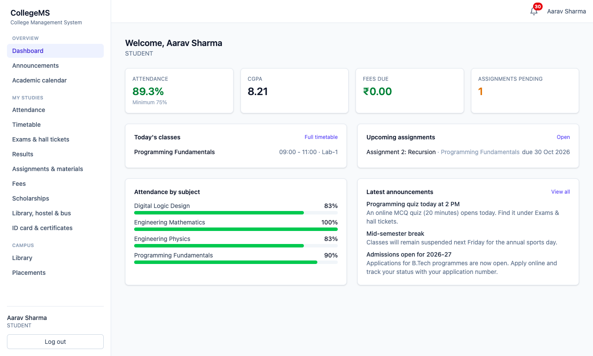{width=100%}

After sign-in every screen has the same structure:

1. **Sidebar (left).** The navigation menu, grouped into **Overview**, **My studies**, **Teaching**, **Academics**, **Finance**, **Campus** and **Administration**. You see only the groups and items your role may use. At the bottom are your name, your role and **Log out**. Click your name to open **Profile & security**.
2. **Top bar.** The bell icon shows the number of unread notifications; click it to open them. For parents there is also a **Viewing** selector for choosing which child's records to show. Your name links to your profile.
3. **Main area.** The screen itself: a heading, a short description, then cards, tables and forms. Many screens have tabs under the heading; click a tab name to switch.
4. **On a phone** the sidebar is hidden. Tap the three-line menu button at the top left to open it, and tap outside it to close it.

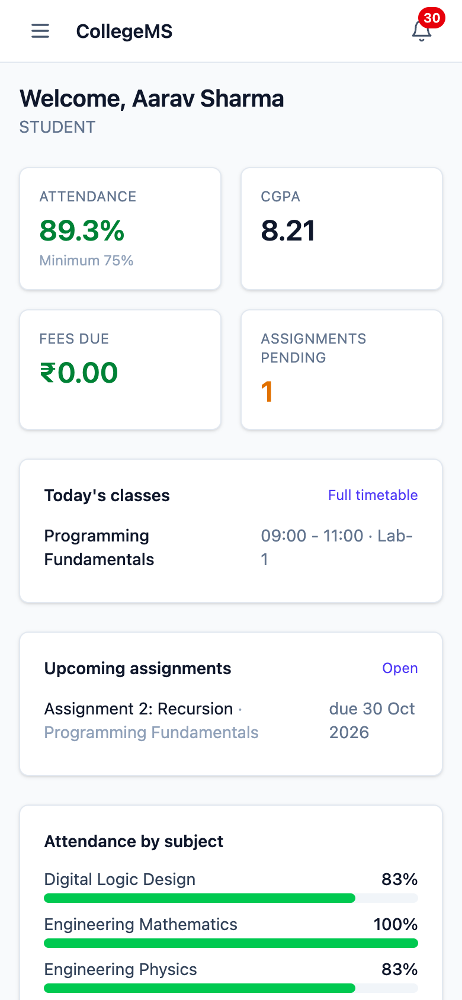{width=40%}

**Tips that apply everywhere.** Green messages confirm that something was saved; red messages explain why something was refused. Tables scroll sideways on small screens. Dates are shown as day, month name, year. A red badge on the bell is the number of unread notifications.

## 7.2 For visitors and applicants (no account needed) {#s7-2}

### 7.2.1 The public home page {#s7-2-1}

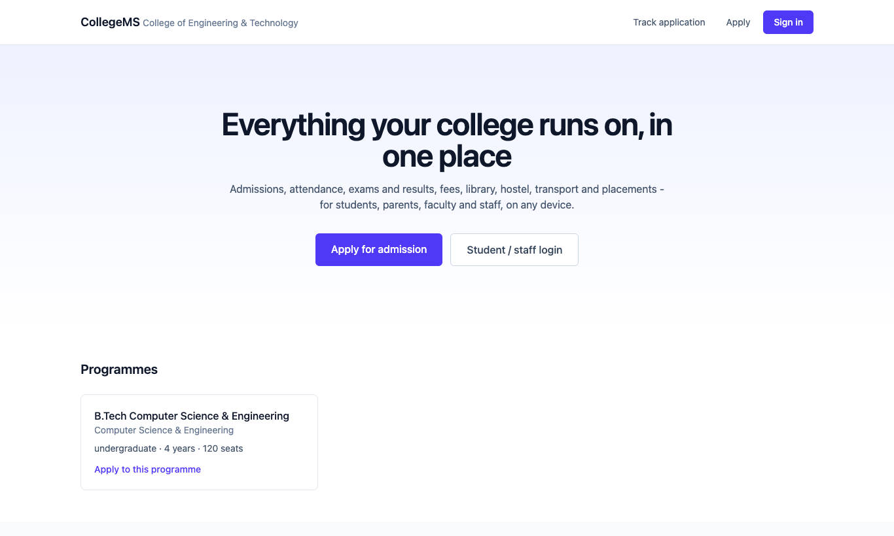{width=100%}

**How to reach it:** open `http://localhost:5173/`.

**What you see.** A short introduction, the programmes the college offers with their duration and seats, public notices posted by the administration, the five admission steps, and the list of departments. The buttons at the top are **Track application**, **Apply** and **Sign in** (or **Open dashboard** if you are already signed in).

**Steps.** To apply, click **Apply for admission** (or **Apply to this programme** under a course). To check a previous application, click **Track application**.

### 7.2.2 Applying for admission {#s7-2-2}

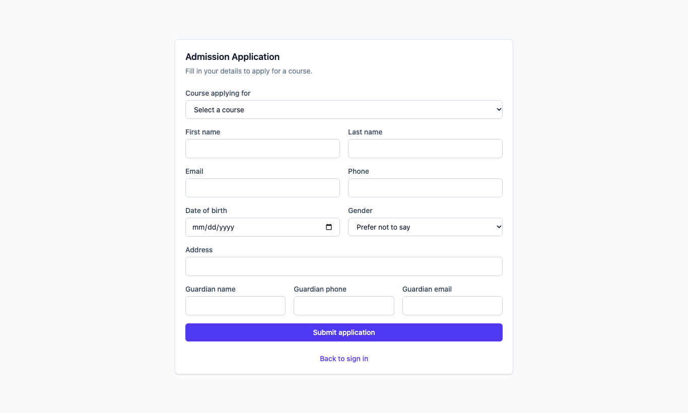{width=100%}

**How to reach it:** home page, then **Apply for admission**, or go to `/apply`.

**Steps.**

1. Choose the **Course applying for**.
2. Fill in first name, last name, email, phone and date of birth. Gender, address and guardian details are optional but recommended, because the guardian becomes the student's parent record if you are enrolled.
3. Click **Submit application**.
4. The next screen shows your **application number** (for example ADM2026731202). Write it down; you need it to track the application.
5. On the same screen, under **Upload your documents**, choose a document type (class 10 or 12 marksheet, ID proof, photo, transfer certificate), choose a file (PDF, image or Word document up to 10 MB) and click **Upload**. Repeat for each document. Uploading moves the application to the status "Documents pending" so the office knows to check them.

### 7.2.3 Tracking an application {#s7-2-3}

**How to reach it:** **Track application** on the home page, or `/track`.

**Steps.** Enter the application number and click **Track**. You see the applicant name, course, current status (Submitted, Documents pending, Under review, Merit listed, Fee pending, Approved, Enrolled, Rejected or Withdrawn), the merit rank once published, and whether the fee has been recorded.

### 7.2.4 Creating an account and signing in {#s7-2-4}

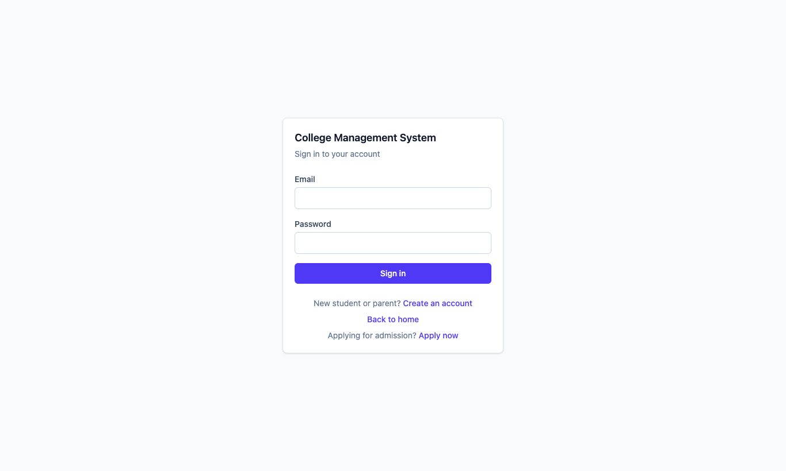{width=70%}

**Registering (students and parents only).** On the sign-in page click **Create an account**. Fill in your details, choose **Student** or **Parent**, and click **Create account**. A six-digit code is sent to your email; enter it and click **Verify email**. You can then sign in. (Enrolled students normally receive their account when they are enrolled and do not need to register. Parents use this route.) All other roles are created by an administrator.

**Signing in.** Enter your email and password and click **Sign in**. If you switched on two-factor sign-in you are asked for a code sent to your email. After sign-in you arrive at your dashboard.

**Forgotten password.** On the sign-in page click **Forgot your password?**, enter your email and click **Send code**. A six-digit code is emailed to you (the screen gives the same answer whether or not the email has an account, so it cannot be used to discover who is registered). Enter the code and a new password of at least 8 characters, then click **Reset password**. You are returned to the sign-in page. If email is not set up on your installation, an administrator can reset your password under **Users & roles**.

## 7.3 For students {#s7-3}

All the student screens are under **My studies** in the sidebar. A student sees only their own records.

### 7.3.1 Dashboard {#s7-3-1}

{width=100%}

**How to reach it:** **Dashboard**, or `/dashboard`.

**What you see.**

- Four cards: **Attendance** (overall percentage, green at or above 75%, red below), **CGPA**, **Fees due**, and **Assignments pending**.
- **Today's classes**: subject, time and room for today, with a link to the full timetable.
- **Upcoming assignments**: titles and due dates, with a link to the assignments screen.
- **Attendance by subject**: a bar for each subject.
- **Latest announcements**.

### 7.3.2 Attendance {#s7-3-2}

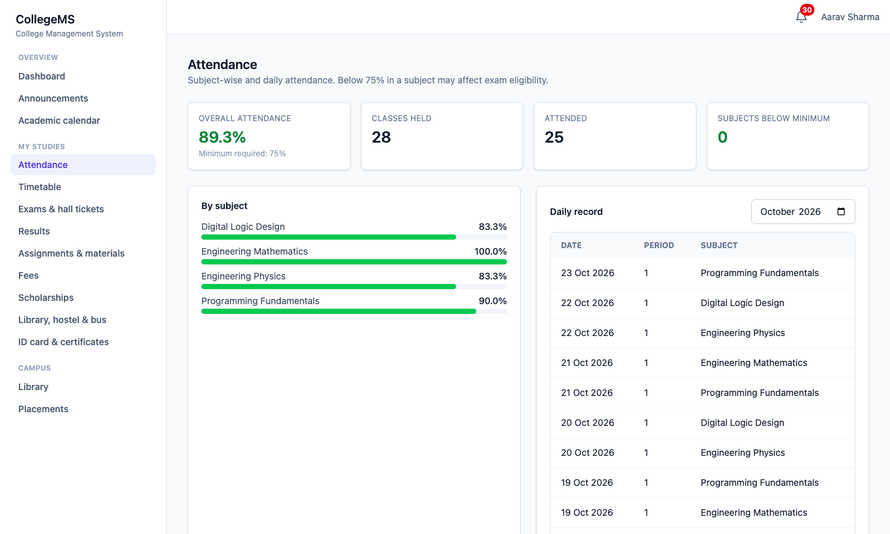{width=100%}

**How to reach it:** sidebar, **My studies**, **Attendance**.

**What you see.** The overall percentage, the number of classes held and attended, and the number of subjects below the 75% minimum. **By subject** shows a bar per subject. **Daily record** lists each class in the chosen month with its status: Present, Absent, Late or Excused.

**Steps.** Use the month picker above the daily record to look at another month. Late counts as attended. Excused classes are left out of the calculation, so they do not lower the percentage.

### 7.3.3 Timetable {#s7-3-3}

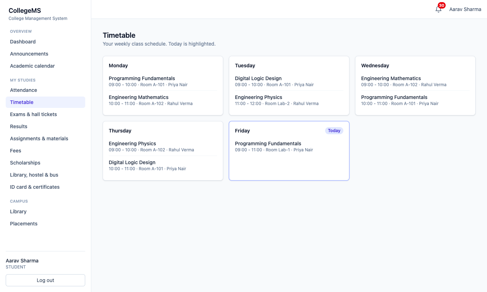{width=100%}

**How to reach it:** **Timetable**.

**What you see.** One card per weekday that has classes, each listing the subject, start and end time, room and teacher. Today's card is outlined and marked **Today**.

### 7.3.4 Exams, hall ticket and online exams {#s7-3-4}

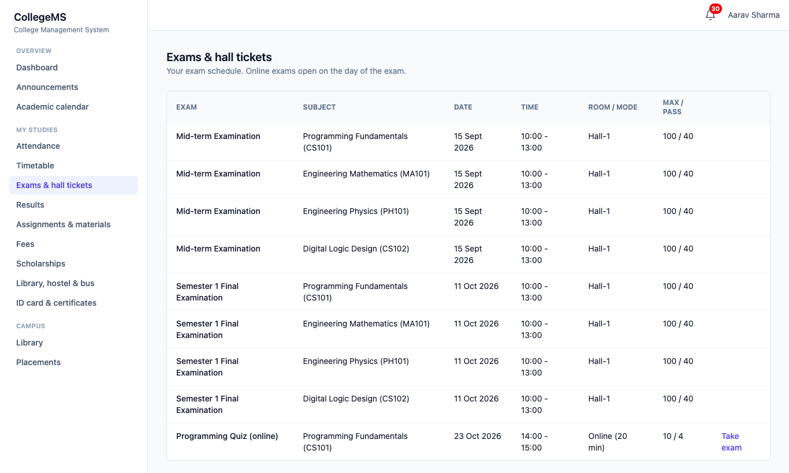{width=100%}

**How to reach it:** **Exams & hall tickets**.

**What you see.** Every paper for your batch with exam name, subject, date, time, room (or "Online" with its duration) and maximum and pass marks. Under the table is your **hall ticket**.

**Printing the hall ticket.** Click **Print hall ticket**; the browser's print dialog opens with only the hall ticket on the page. Choose a printer or "Save as PDF".

**Taking an online exam.**

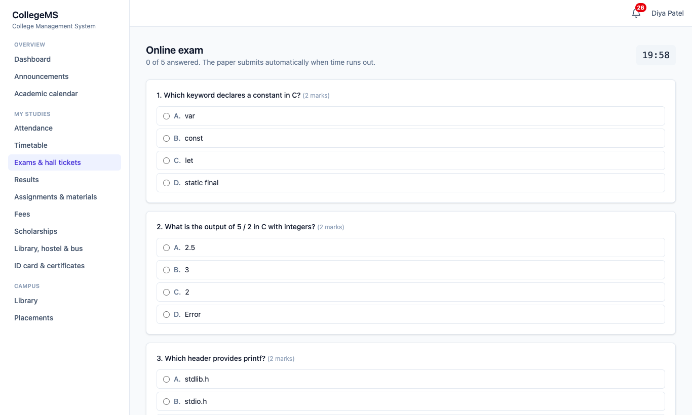{width=100%}

1. On the day of the exam, a **Take exam** link appears on the online paper. Before that day it says "Opens on exam day"; afterwards it says "Closed".
2. Click **Take exam**. The question paper opens and a countdown timer starts at the top right. The timer turns red in the last two minutes.
3. Choose one option for each question. The header shows how many you have answered.
4. Click **Submit exam**. If the time runs out the paper submits itself automatically with the answers chosen so far.
5. You immediately see your marks (for example 8 / 10). The official grade appears later, after the college publishes results.

You can attempt each online exam once. If you close the browser and come back, the same timer continues.

### 7.3.5 Results {#s7-3-5}

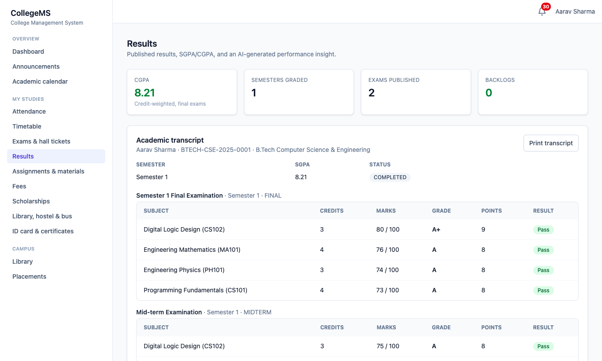{width=100%}

**How to reach it:** **Results**.

**What you see.** Cards for **CGPA**, the number of semesters graded, the number of exams published and the number of backlogs. The **Academic transcript** shows the SGPA of each semester and, for each published exam, every subject with credits, marks, grade, grade points and Pass or Fail. At the bottom is the **AI performance insight** (see Section 9): a risk level, the reasons, a forecast of your next exam score and suggestions.

**Printing a transcript.** Click **Print transcript**.

Results appear only after the college has published an exam. See Section 8 for how grades and CGPA are calculated.

### 7.3.6 Fees {#s7-3-6}

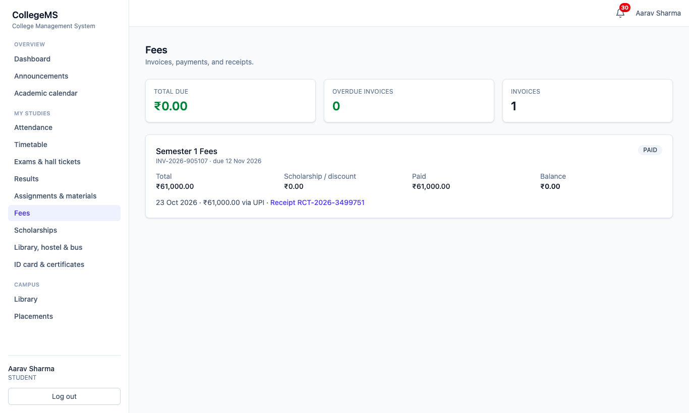{width=100%}

**How to reach it:** **Fees**.

**What you see.** **Total due**, the number of overdue invoices, and a card for each invoice showing total, scholarship discount, amount paid and balance. An **OVERDUE** badge appears when the due date has passed with a balance outstanding. Each payment is listed with a receipt link.

**Paying online (demonstration).**

1. On an unpaid invoice, the amount box is filled with the full balance. Change it to pay part of the invoice.
2. Click **Pay online**. The demonstration gateway always succeeds; no real money moves.
3. The balance updates and a receipt appears. Click the receipt number to open it.

**Receipt.** The receipt page shows receipt number, date, student, course, invoice, method, the amount received and the invoice position. Click **Print receipt** to print it.

### 7.3.7 Assignments and study materials {#s7-3-7}

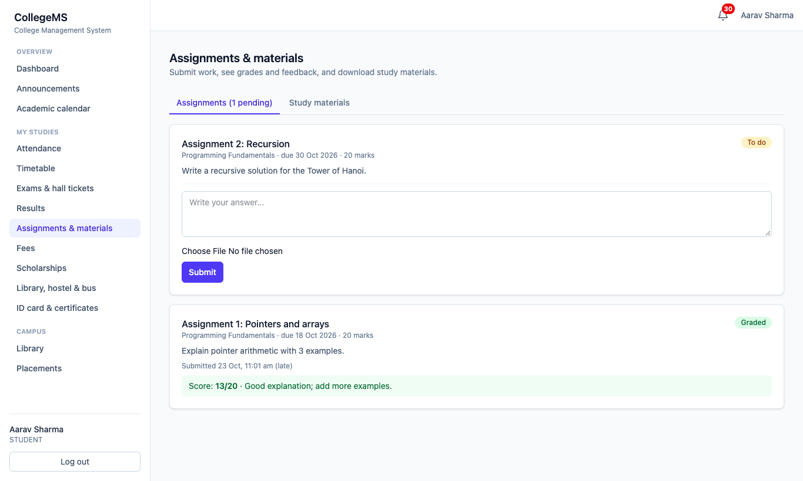{width=100%}

**How to reach it:** **Assignments & materials**.

**Assignments tab.** Each assignment shows its subject, due date, maximum marks and instructions. A badge shows its state: To do, Submitted, Submitted late, Graded or Missed.

1. To submit, type your answer in the box and optionally choose a file, then click **Submit**.
2. To change a submission before it is graded, click **Edit submission** and **Resubmit**.
3. Once graded, you see your score and the teacher's feedback, and the submission can no longer be changed.

**Study materials tab.** Files and links shared by your teachers. Click **Download** or **Open link**.

### 7.3.8 Library, hostel and transport {#s7-3-8}

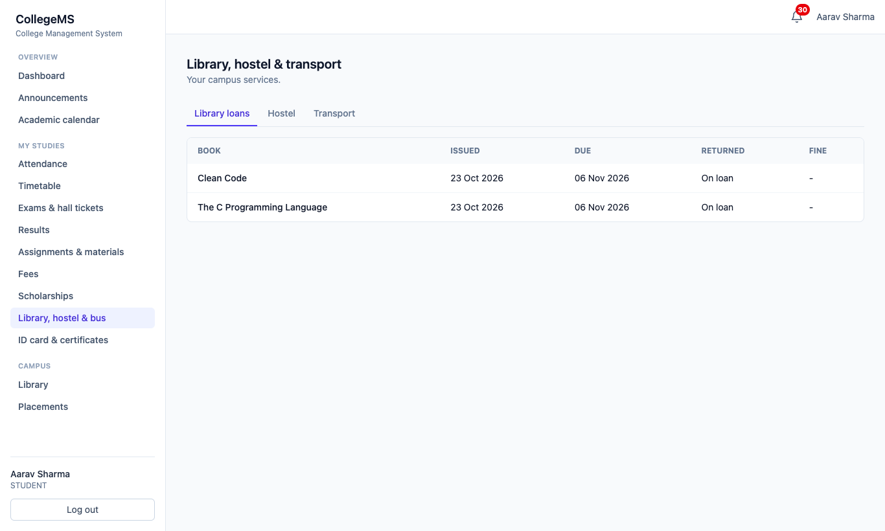{width=100%}

**How to reach it:** **Library, hostel & bus**. It has three tabs.

- **Library loans**: books you have borrowed, issue and due dates, whether returned, and any fine.
- **Hostel**: your room, hostel, start date and fee per term. If you have a room you can raise a complaint with **Submit complaint**; the table below tracks its status (Open, In progress, Resolved) and the warden's resolution.
- **Transport**: your route, pickup stop and time, vehicle, driver and fee.

To search the library catalog use **Library** in the sidebar (Section 7.9).

### 7.3.9 Scholarships {#s7-3-9}

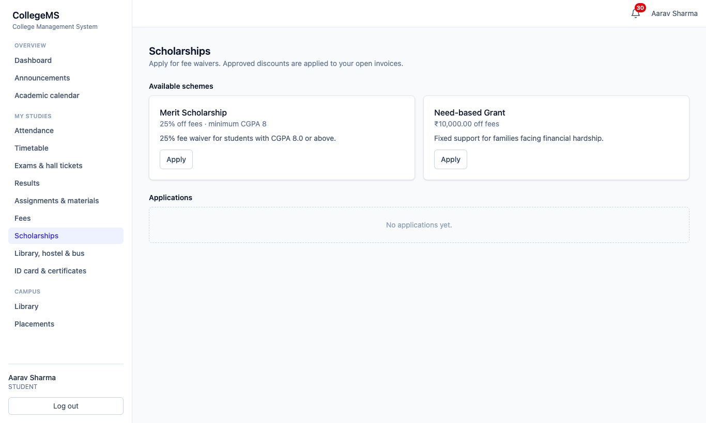{width=100%}

**How to reach it:** **Scholarships**.

**Steps.** Each open scheme shows its discount and any minimum CGPA. Click **Apply**, write why you should receive it, and click **Submit application**. If a scheme has a CGPA minimum and your published results are below it, the application is refused with a message. The **Applications** table shows Applied, Approved or Rejected and, if approved, the discount applied to your invoices.

### 7.3.10 ID card, certificate and documents {#s7-3-10}

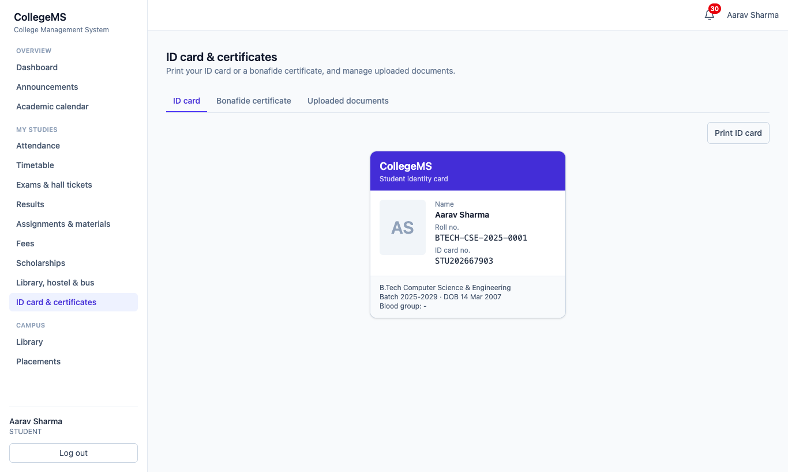{width=100%}

**How to reach it:** **ID card & certificates**. It has three tabs.

- **ID card**: a printable card with name, roll number, ID card number, course, batch, date of birth and blood group. Click **Print ID card**.
- **Bonafide certificate**: a certificate stating that you are enrolled. Click **Print certificate**.
- **Uploaded documents**: your documents with a **Download** link, and a form to upload another (choose the type, choose a file, click **Upload**).

### 7.3.11 Placements {#s7-3-11}

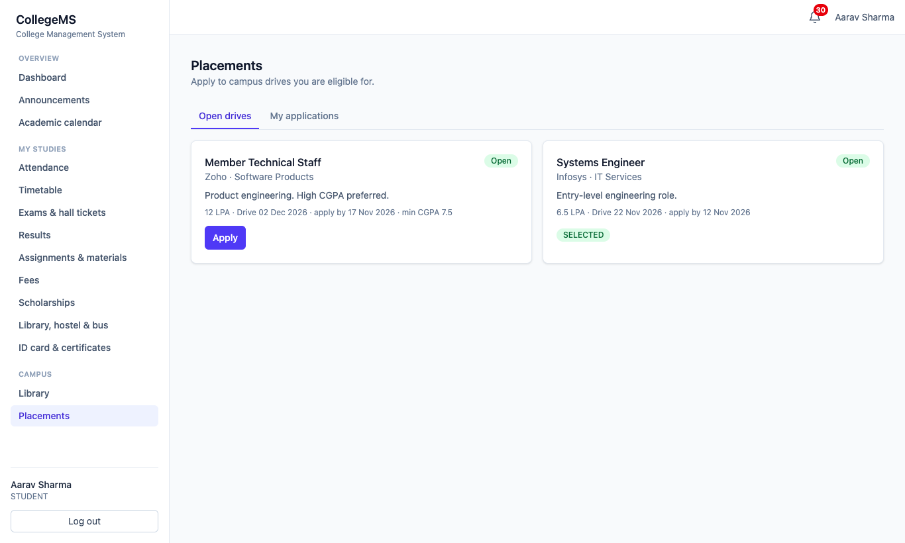{width=100%}

**How to reach it:** **Placements** (Campus group). Students see the **Open drives** and **My applications** tabs.

**Steps.** Each drive shows the company, role, package, drive date, apply-by date, and any minimum CGPA or course restriction. If you meet the conditions an **Apply** button appears; if not, the reason is shown (for example "A minimum CGPA of 7.5 is required"). After applying, the badge shows the stage as the placement cell updates it.

## 7.4 For parents {#s7-4}

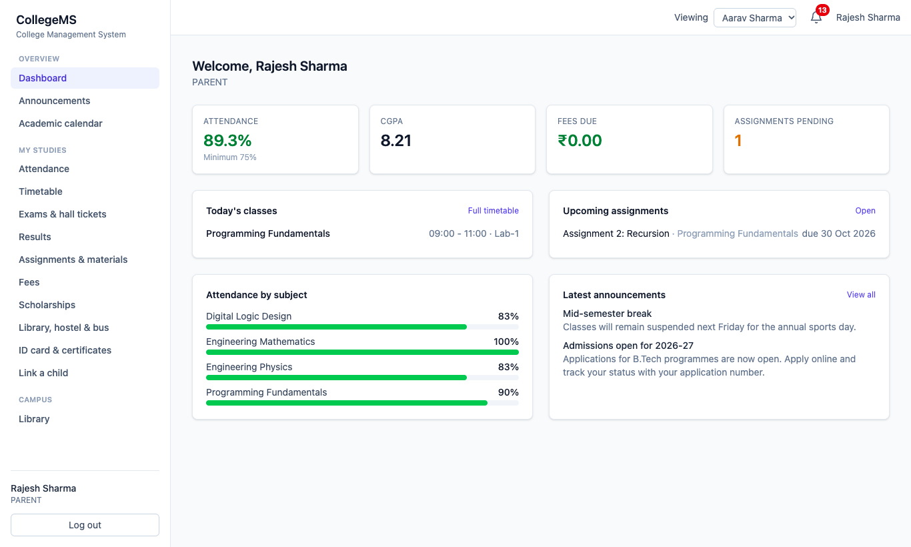{width=100%}

A parent sees the same screens as a student (attendance, timetable, exams, results, assignments, fees, scholarships, hostel and transport, documents) for the child selected in the **Viewing** box at the top. Parents can read everything and can pay fees, but cannot submit assignments or take exams.

### 7.4.1 Linking a child {#s7-4-1}

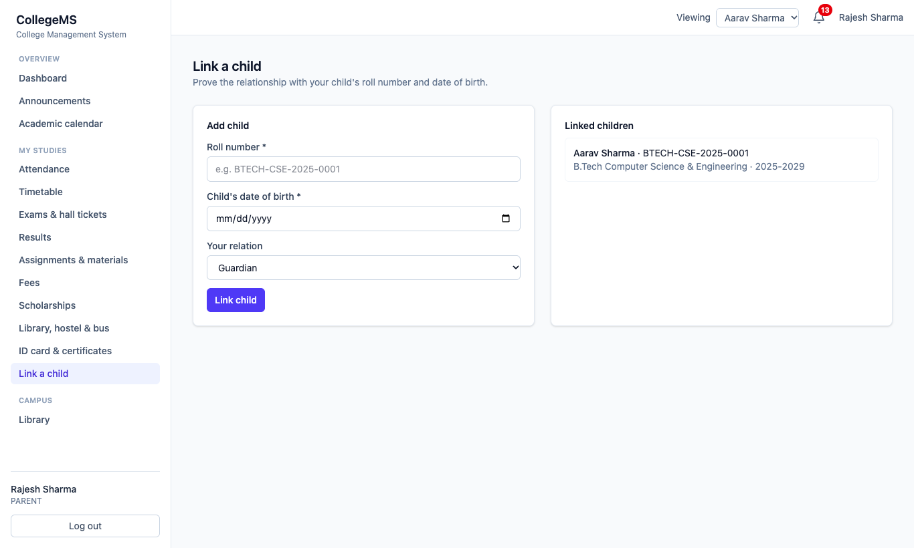{width=100%}

A newly registered parent has no children linked. To link one:

1. Click **Link a child** in the sidebar.
2. Enter the child's **roll number** and **date of birth**. This is how the system confirms the relationship.
3. Choose your relation (Father, Mother or Guardian) and click **Link child**.
4. The page reloads and the child appears in the **Viewing** selector. Repeat for more children.

If the roll number and date of birth do not match a student, nothing is linked.

## 7.5 For notifications, announcements and your profile (everyone) {#s7-5}

### 7.5.1 Notifications {#s7-5-1}

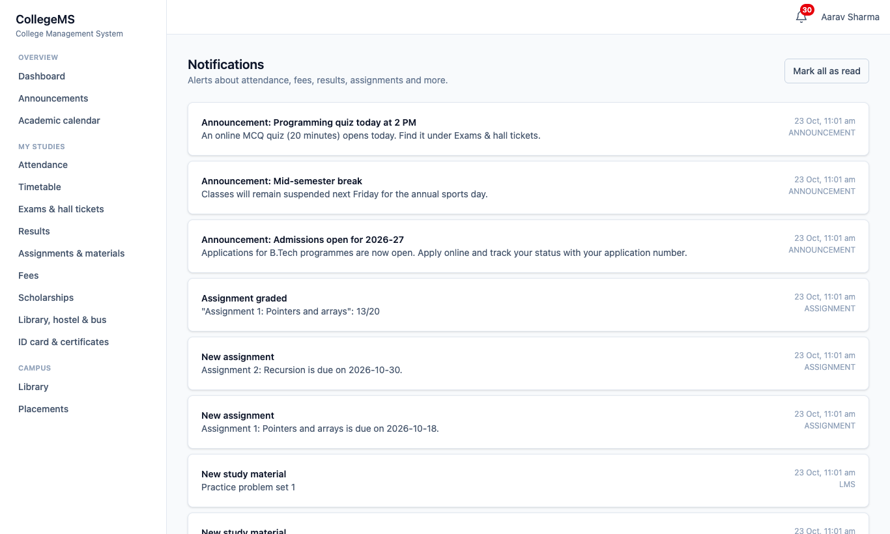{width=100%}

**How to reach it:** click the bell icon.

The system creates notifications for you automatically: absences, new invoices and payments, published results, new exams, assignments and grades, library fines, hostel and transport allocation, leave decisions, scholarship decisions, placement updates, announcements and broadcasts. Unread items are highlighted. Click one to mark it read and go to the related screen. **Mark all as read** clears the list.

### 7.5.2 Announcements {#s7-5-2}

**How to reach it:** **Announcements**.

Everyone sees the announcements meant for their audience. Administrators, principals, HODs and faculty see a **Post an announcement** form: enter a title and message, choose the audience (everyone, students, parents, faculty or staff), optionally limit it to one batch, and click **Post**. Faculty must choose a batch. Administrators can tick **Show on the public website** to publish a notice on the home page. Posting also sends a notification to the audience.

### 7.5.3 Academic calendar {#s7-5-3}

**How to reach it:** **Academic calendar**. Lists holidays, exam periods and semester dates in order. Administrators, principals and HODs can add events with the form on the right.

### 7.5.4 Profile and security {#s7-5-4}

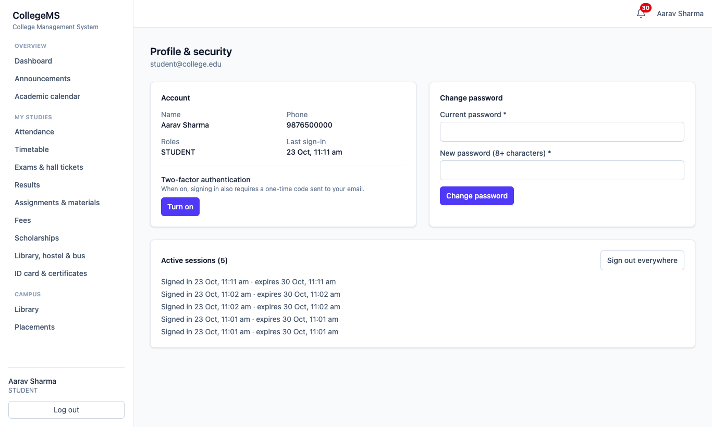{width=100%}

**How to reach it:** click your name in the sidebar or the top bar.

- **Account** shows your details and last sign-in.
- **Two-factor authentication**: click **Turn on** to require an emailed code at each sign-in.
- **Change password**: enter your current password and a new one (at least 8 characters).
- **Active sessions** lists where you are signed in. **Sign out everywhere** cancels every session, including this one.

## 7.6 For faculty {#s7-6}

Faculty use the **Teaching** group, plus **Timetable**, **Students**, **AI performance analytics** and **Library**.

### 7.6.1 Marking attendance {#s7-6-1}

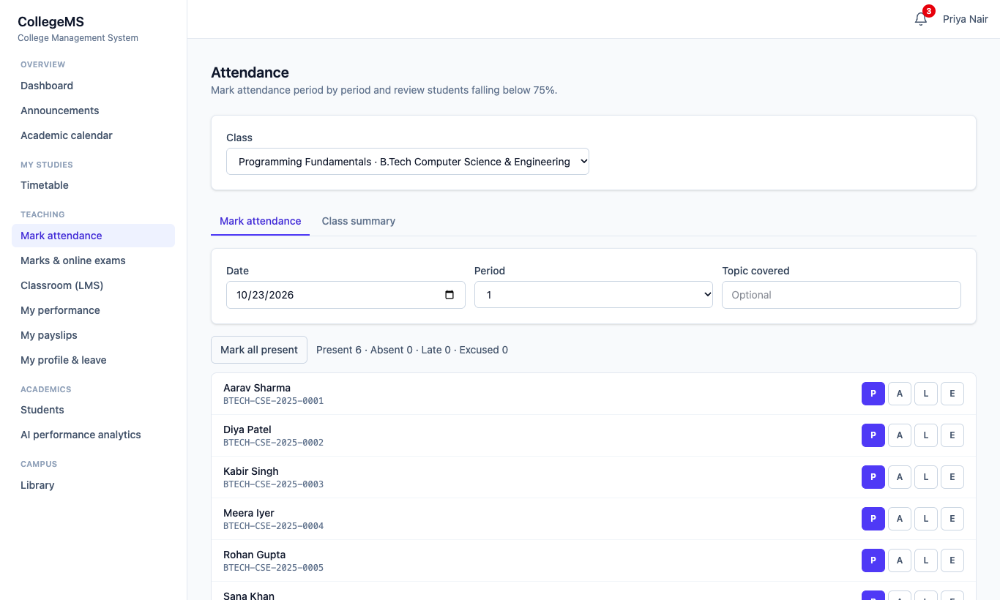{width=100%}

**How to reach it:** **Teaching**, **Mark attendance**.

**Steps.**

1. In **Class**, choose one of the subject and batch combinations allocated to you. (If the list is empty, ask your HOD or administrator to allocate your subjects; see Section 7.8.5.)
2. Choose the **Date** (today or earlier) and the **Period** (1 to 8). Optionally enter the **Topic covered**.
3. The roster of the batch appears with a row per student. Each row has four buttons: **P** (Present), **A** (Absent), **L** (Late) and **E** (Excused). Everyone starts as Present. Click **Mark all present** to reset, then click **A**, **L** or **E** for the exceptions.
4. A summary line shows how many are present, absent, late and excused.
5. Click **Save attendance**. Students who are newly marked absent receive a notification, and so do their parents.

If you open a period that was already marked, the saved statuses are shown and you can correct them.

**Class summary tab.** Shows each student's attended and held classes and percentage for the chosen subject. Anyone below 75% is marked **(low)** in red.

### 7.6.2 Entering marks and building an online exam {#s7-6-2}

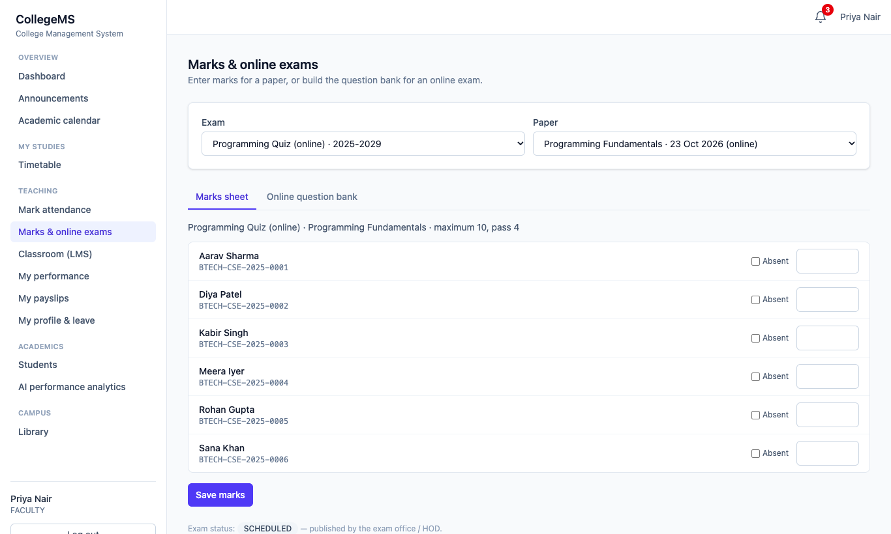{width=100%}

**How to reach it:** **Teaching**, **Marks & online exams**.

**Entering marks.**

1. Choose the **Exam** and then the **Paper** (subject). Exams are created by the exam office (Section 7.8.4).
2. The **Marks sheet** tab lists the batch. For each student type the marks, or tick **Absent**. Marks must be between zero and the maximum.
3. Click **Save marks**. You can save partway and return later. Only the faculty allocated to that subject, an HOD or an administrator can enter marks.
4. After the exam is published by the exam office, the sheet becomes read-only.

**Building an online exam.** When the chosen paper is online, a second tab, **Online question bank**, appears. Fill in the question, two to four options, the correct answer and the marks, then click **Add question**. The list on the right shows the paper as students will see it, with the correct answers visible only to you; use **Remove** to delete a question. Students cannot start the exam until at least one question exists. When students submit, the marks are filled in automatically (scaled to the paper's maximum if the question marks add up to something different).

### 7.6.3 Classroom: assignments and study materials {#s7-6-3}

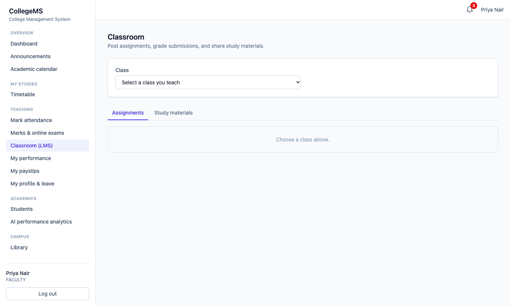{width=100%}

**How to reach it:** **Teaching**, **Classroom (LMS)**. Choose a class first.

**Assignments tab.**

1. Fill in **Post an assignment** (title, instructions, due date, maximum marks) and click **Post & notify class**. Every student in the batch is notified.
2. The table shows how many students have submitted and how many are graded. Click **Review** to open the submissions.
3. For each student you can read the answer, download an attached file, enter marks (up to the maximum) and feedback, and click **Grade**. The student is notified.

**Study materials tab.** Enter a title, optionally a description, and either a web link (starting with https://) or choose a file, then click **Share**. The batch is notified.

### 7.6.4 My performance, payslips and leave {#s7-6-4}

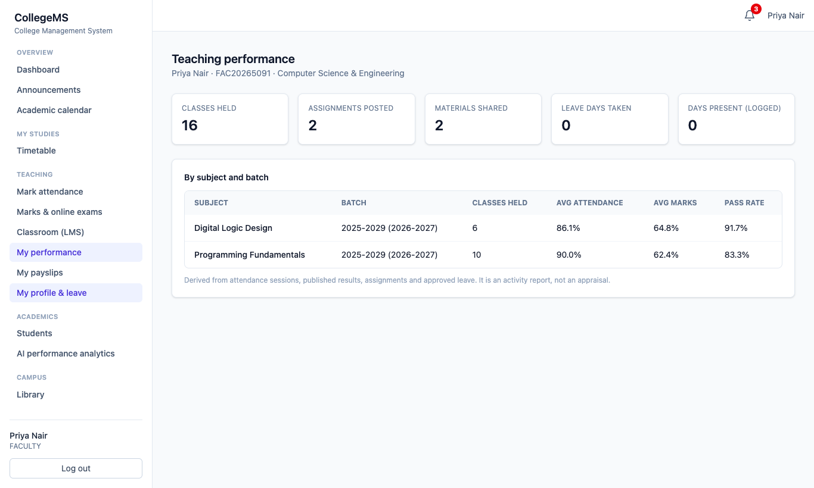{width=100%}

**My performance** (sidebar) shows classes held, assignments posted, materials shared, leave days taken and days present, followed by a table for each subject and batch you teach: classes held, average attendance, average marks and pass rate. It is an activity report built from the system's records, not an appraisal.

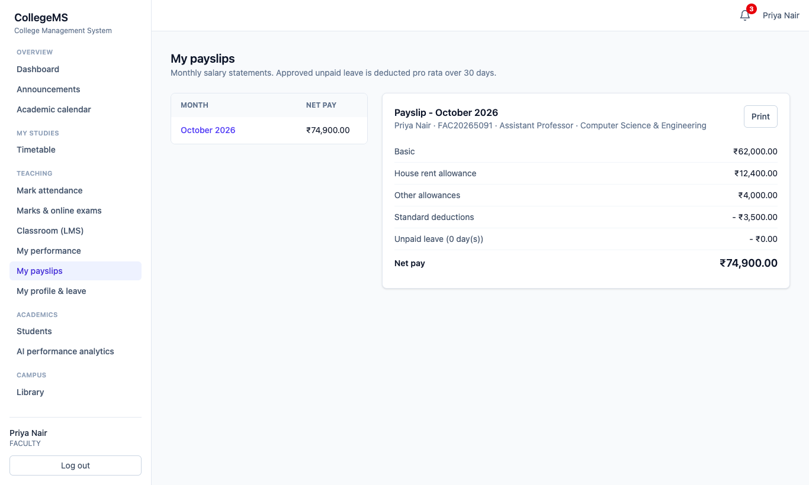{width=100%}

**My payslips** lists your payslips by month. Click a month to see the breakdown (basic, house rent allowance, other allowances, standard deductions, unpaid leave deduction, net pay). Click **Print** to print it.

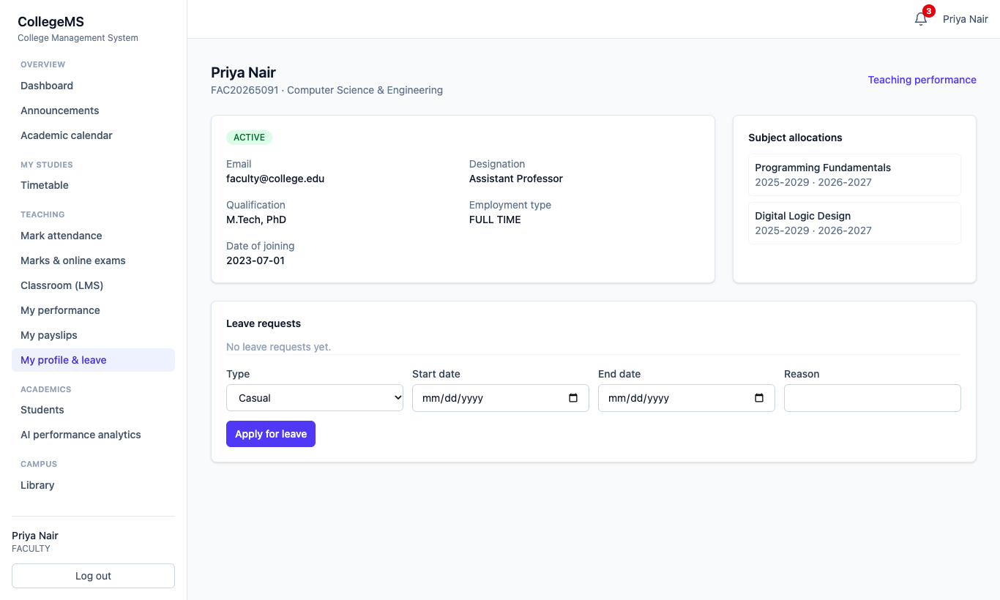{width=100%}

**My profile & leave** shows your details, your subject allocations and your leave requests. To apply for leave choose the type (Casual, Sick, Earned or Unpaid), the dates and a reason, then click **Apply for leave**. Your HOD, or the administrator if there is no HOD, is notified and decides the request; you are notified of the decision.

### 7.6.5 AI performance analytics for teachers {#s7-6-5}

Faculty, HODs, the principal and administrators can open **AI performance analytics**. It is explained in Section 7.8.6.

## 7.7 For the principal and HODs {#s7-7}

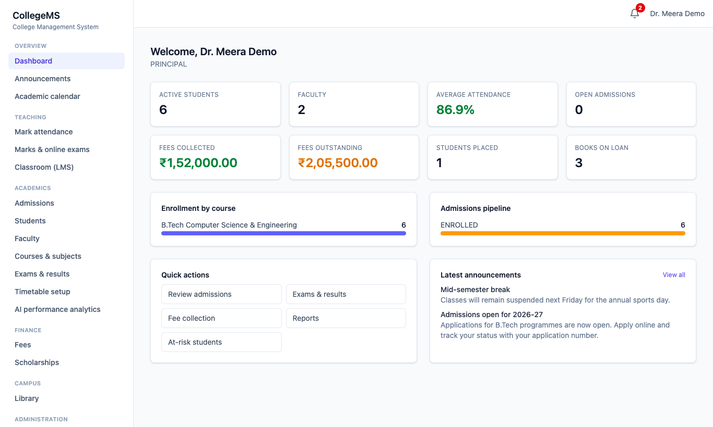{width=100%}

**Dashboard.** Cards for active students, faculty, average attendance, open admissions, fees collected and outstanding, students placed and books on loan; charts for enrollment by course and the admissions pipeline; and quick links.

The principal and HODs also use **Admissions**, **Students**, **Faculty**, **Courses & subjects**, **Exams & results**, **Timetable setup**, **AI performance analytics**, **Reports & analytics**, and the finance views. The principal can additionally use **Communications** and post public announcements.

## 7.8 For administrators and the academic office {#s7-8}

### 7.8.1 Administering admissions {#s7-8-1}

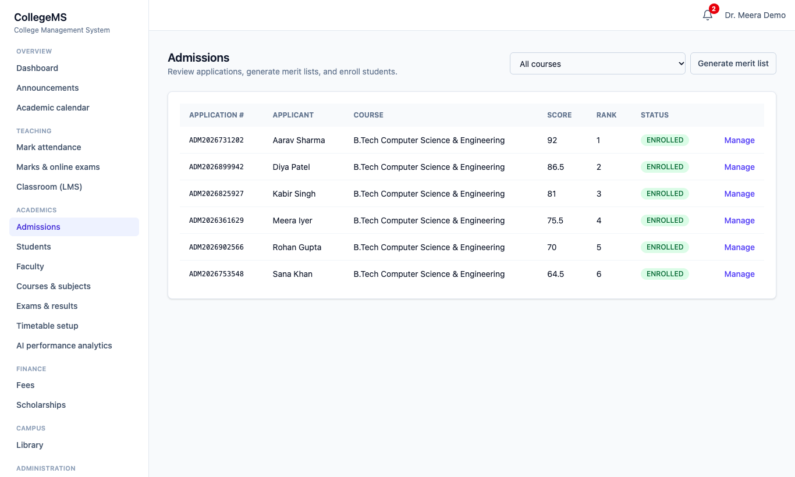{width=100%}

**How to reach it:** **Academics**, **Admissions**.

The list shows every application with its number, name, course, entrance score, merit rank and status. Use the course filter at the top to focus on one programme.

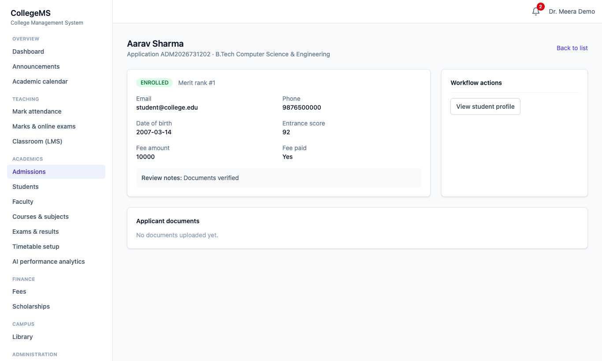{width=100%}

**Processing an application.** Click **Manage** on a row. The left card shows the applicant's details and status; the right card shows the actions available for the current status; the **Applicant documents** card lists uploaded documents with **Download** and **Verify**.

| Step | Status before | Who | What to do | Status after |
|---|---|---|---|---|
| 1 | Submitted or Documents pending | Admin, Principal, HOD | Check and **Verify** each document. Enter the **Entrance exam score** and notes, click **Mark under review** | Under review |
| 2 | Under review | Admin, Principal | Back on the list, choose the course and click **Generate merit list**. All reviewed applicants for that course are ranked by score | Merit listed |
| 3 | Merit listed | Admin, Principal, HOD | Open the application and click **Approve** | Fee pending |
| 4 | Fee pending | Admin, Accountant | Enter the **Admission fee amount** and click **Record fee payment** | Approved |
| 5 | Approved with fee paid | Admin | Choose the **Batch** and click **Enroll student** | Enrolled |

At step 5 the system creates the student's account, a roll number and an ID card number, links the guardian as a parent record, and shows a message with the roll number and a **temporary password**. Give it to the student securely; they should change it at first sign-in. At any stage before enrollment **Reject** is available. An enrolled application has a **View student profile** button.

### 7.8.2 Students and faculty {#s7-8-2}

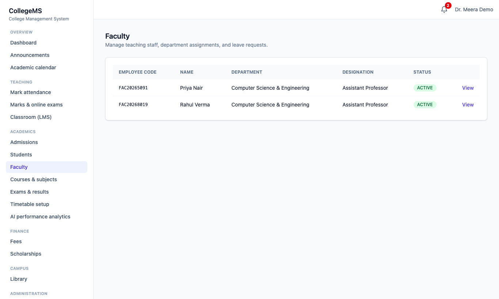{width=100%}

**Students** lists enrolled students with roll number, course, batch, semester and status; filter by course. Click **View** to see a student's profile, guardians and academic history, and **ID card, certificates & documents** at the top to print an ID card or certificate.

**Registering a faculty member.**

1. Click **Faculty**, then **Register faculty** (administrators only).
2. Enter name, email, phone, department, designation, qualification, date of joining and employment type, then click **Register faculty**.
3. The system creates the login and the profile. Note the **temporary password** shown and give it to the teacher.

### 7.8.3 Allocating subjects to faculty {#s7-8-3}

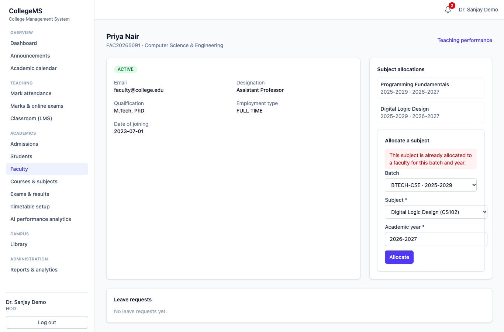{width=100%}

A teacher can mark attendance and enter marks only for subjects allocated to them.

1. Open **Faculty** and click **View** next to the teacher.
2. In **Allocate a subject**, choose the **Batch**, then the **Subject** and the **Academic year**.
3. Click **Allocate**. If the subject is already allocated to someone for that batch and year, the system refuses; the figure shows that message.

### 7.8.4 Courses, subjects, batches, exams and timetable {#s7-8-4}

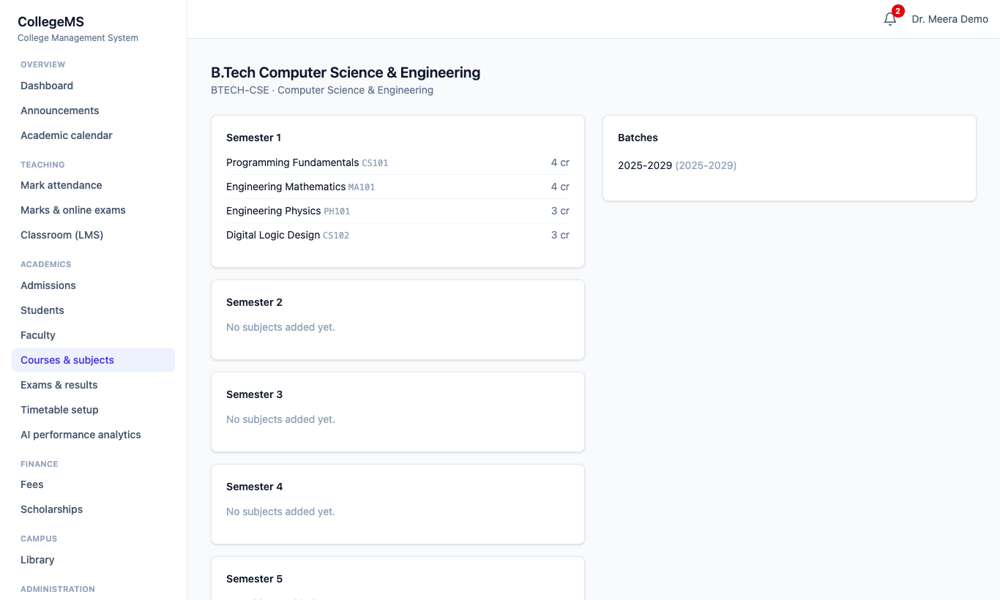{width=100%}

**Courses & subjects.** Add a course with its department, duration, number of semesters and seats; the semesters are created automatically. Click **Manage** on a course to see its semesters. Use **Add subject** (semester, name, code, credits) and **Add batch** (name such as 2026-2030, start and end year).

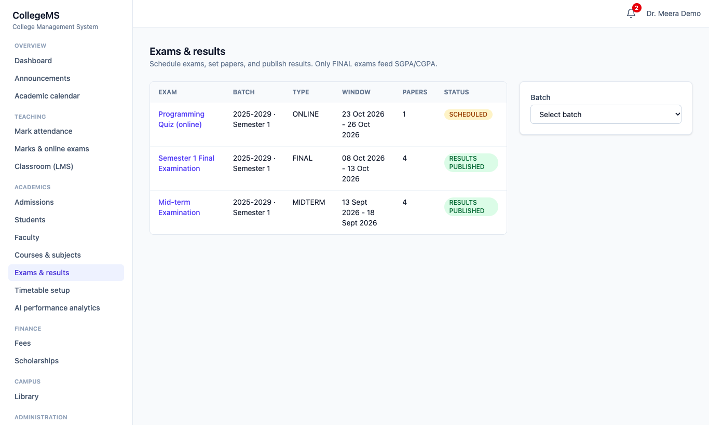{width=100%}

**Exams & results.**

1. Choose a **Batch**, then fill in **Create an exam**: name, type (Internal, Midterm, Final or Online), semester, academic year and the start and end dates.
2. Click the exam name to open it, then use **Add a paper** for each subject: date (inside the exam window), times, room, maximum marks, pass marks, and, for an online paper, tick **Online (MCQ) exam** and give the duration in minutes.
3. Teachers enter marks (Section 7.6.2).
4. When every paper has marks for every student (or an absence), click **Publish results**.

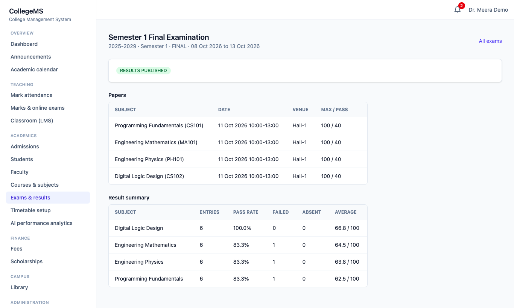{width=100%}

Publishing assigns grades and grade points, writes SGPA for final exams, locks the marks, and notifies students and parents. If any marks are missing the system refuses and tells you how many. After publishing, the page also shows a **Result summary** with pass rate and average for each subject.

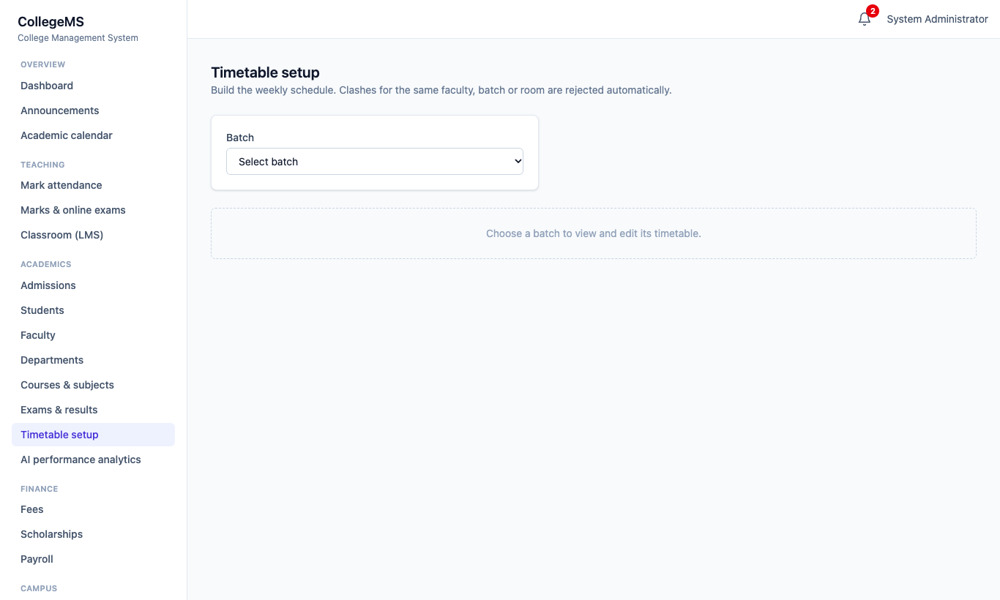{width=100%}

**Timetable setup.** Choose a batch to see its weekly timetable. In **Add a class** choose the subject, faculty member, day, start and end time, room and academic year, then **Add to timetable**. The system refuses a class that clashes with the same teacher, the same batch or the same room at an overlapping time. **Remove** deletes a slot.

### 7.8.5 Managing users and roles {#s7-8-5}

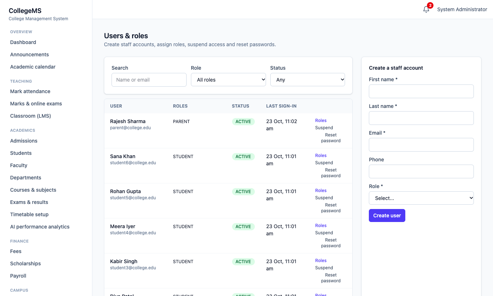{width=100%}

**How to reach it:** **Administration**, **Users & roles** (Super Admin and College Admin).

- **Search and filter** by name or email, role and status.
- **Create a staff account**: enter name, email and role, then **Create user**. A temporary password is shown once.
- **Roles**: click **Roles** next to a user, tick the roles, and **Save roles**. Only a Super Admin can grant administrator roles.
- **Suspend / Activate**: a suspended user is locked out immediately.
- **Reset password**: generates a new temporary password, shown once, and signs the user out everywhere.

### 7.8.6 AI performance analytics {#s7-8-6}

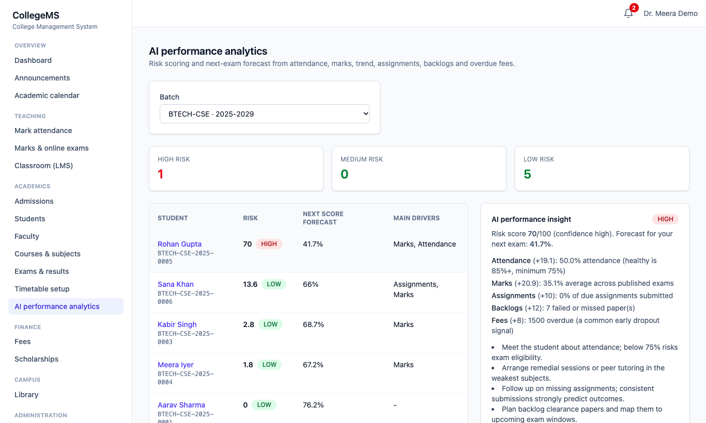{width=100%}

**How to reach it:** **Academics**, **AI performance analytics**.

**Steps.**

1. Choose a batch. The three cards count students at High, Medium and Low risk.
2. The table ranks students from highest to lowest risk with the risk score, a forecast of the next exam score, and the two main drivers.
3. Click a student's name. The panel on the right lists each factor with the points it adds and why, followed by suggested actions.

How the score is calculated is explained in Section 9.

### 7.8.7 Reports and communications {#s7-8-7}

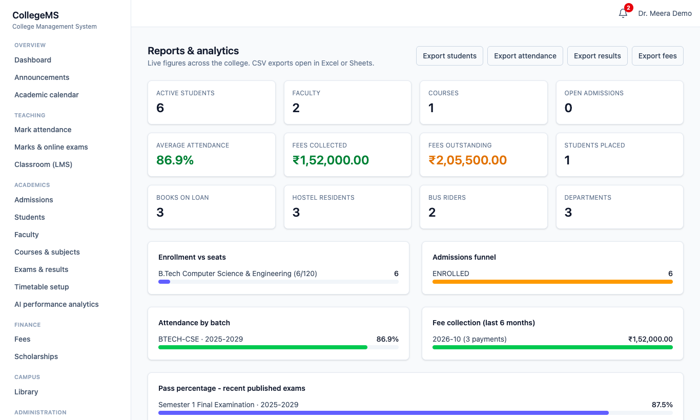{width=100%}

**Reports & analytics** shows the headline figures and five charts: enrollment against seats, the admissions funnel, attendance by batch, fee collection over six months and pass percentage of recent exams. The buttons at the top (**Export students**, **Export attendance**, **Export results** and, for finance roles, **Export fees**) download a CSV file that opens in Excel.

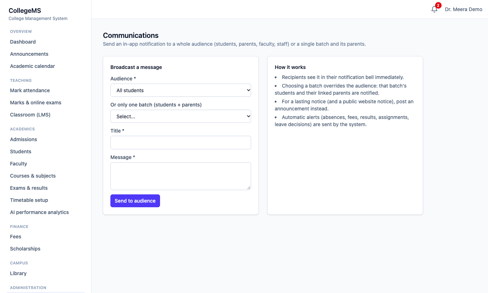{width=100%}

**Communications** sends an immediate notification to an audience. Choose **Everyone**, **All students**, **All parents**, **All faculty** or **All staff**, or choose one batch to reach its students and their parents, enter a title and message and click **Send to audience**. The confirmation says how many people received it.

## 7.9 For the accounts office {#s7-9}

### 7.9.1 Fees {#s7-9-1}

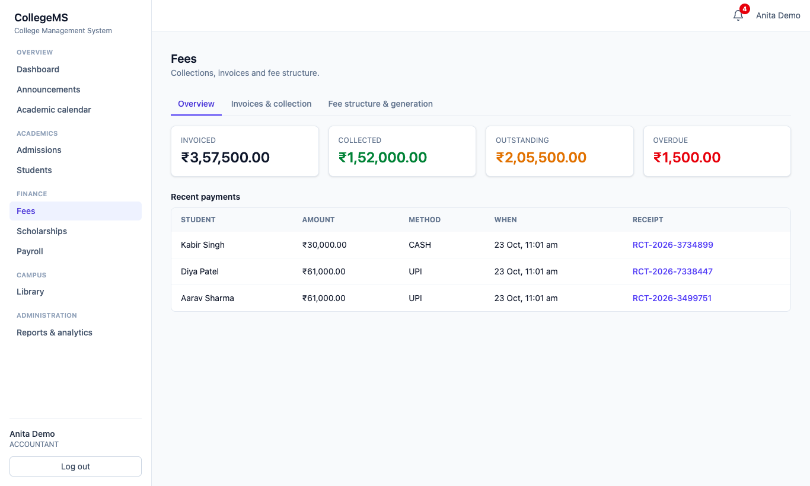{width=100%}

**How to reach it:** **Finance**, **Fees**. Three tabs.

**Overview.** Total invoiced, collected, outstanding and overdue, and the latest payments with receipt links.

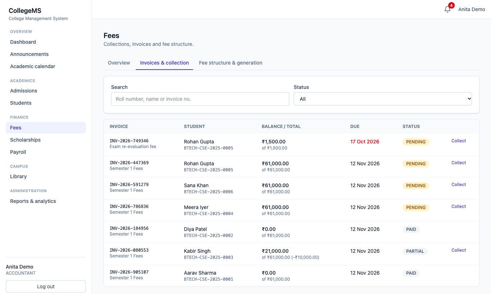{width=100%}

**Invoices & collection.** Search by roll number, name or invoice number and filter by status. To record a payment click **Collect**, enter the amount, choose Cash, Card, UPI or Bank, and click **Save**; a receipt number is created. Principals and administrators also see **Waive** for forgiving an invoice. Overdue due dates are shown in red.

**Fee structure & generation.**

1. Choose a course and add its fee heads (for example Tuition 55,000 and Laboratory 6,000) with **Add fee head**. A head can apply to one semester or to every semester.
2. Choose a batch, enter an invoice title such as "Semester 1 fees", choose the semester and the due date and click **Generate invoices**. One invoice is created for every active student, totalling the matching heads. Running it again with the same title creates nothing new.

### 7.9.2 Scholarships {#s7-9-2}

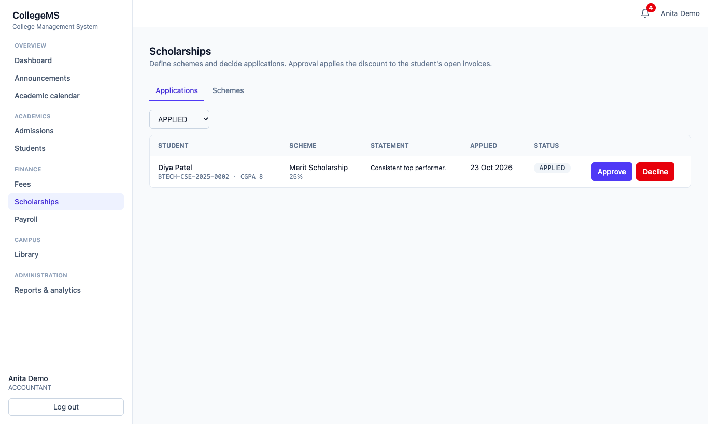{width=100%}

**Finance**, **Scholarships**. The **Applications** tab lists applications by status with the student's CGPA and statement. **Approve** applies the discount to the student's open invoices and notifies them; **Decline** asks for an optional reason. The **Schemes** tab creates schemes (name, percentage or fixed amount, optional minimum CGPA) and opens or closes them.

### 7.9.3 Payroll {#s7-9-3}

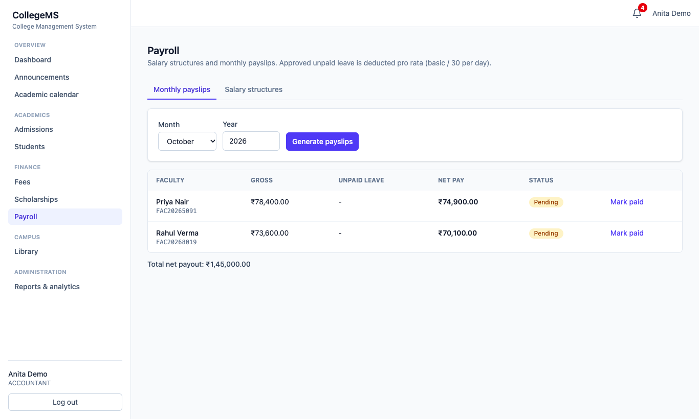{width=100%}

**Finance**, **Payroll**.

1. On **Salary structures**, enter basic pay, house rent allowance, allowances and deductions for each faculty member and click **Save**.
2. On **Monthly payslips**, choose the month and year and click **Generate payslips**. Approved unpaid leave in that month is deducted. Regenerating before payment recalculates; paid payslips are left alone.
3. Click **Mark paid** on each payslip once salary is paid. The total net payout is shown below the table. Faculty see their own payslips under **My payslips**.

## 7.10 For the librarian {#s7-10}

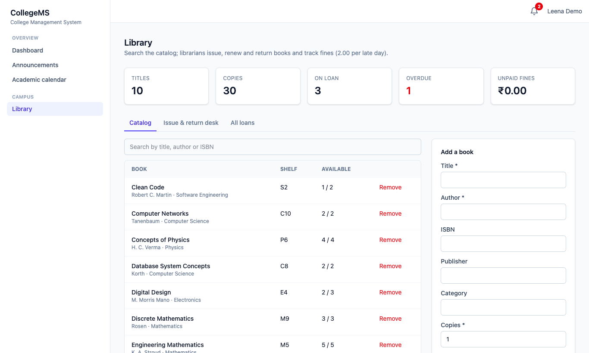{width=100%}

**How to reach it:** **Campus**, **Library**. Everyone can search the catalog by title, author or ISBN and see how many copies are available. Librarians also see library statistics and three tabs.

**Catalog.** **Add a book** with title, author, ISBN, publisher, category, copies and shelf location. **Remove** deletes a book that has no copies on loan.

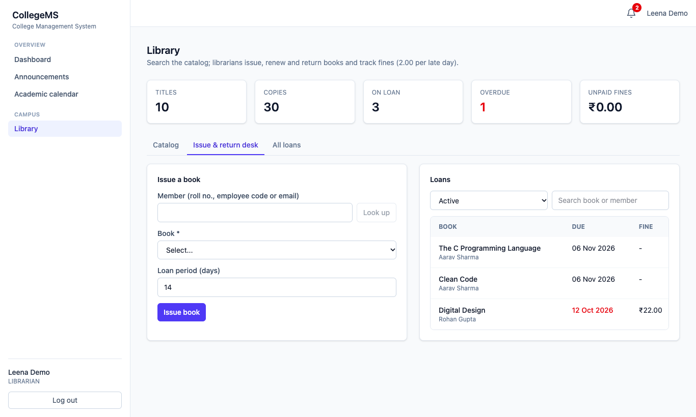{width=100%}

**Issue & return desk.**

1. Type the member's roll number, employee code or email and click **Look up**. You see their name, books out against their limit (3 for students, 5 for faculty, 2 for others) and any unpaid fine.
2. Choose the book and the loan period (default 14 days) and click **Issue book**. The system refuses if no copy is available, the limit is reached, the member has an overdue book or an unpaid fine, or already holds that book.

**All loans.** Filter by Active, Overdue, Unpaid fines or Returned. For each loan: **Return** (a fine of 2.00 per late day is calculated), **Renew** (7 more days, up to twice, not allowed once overdue) and **Mark fine paid**.

## 7.11 For the hostel warden {#s7-11}

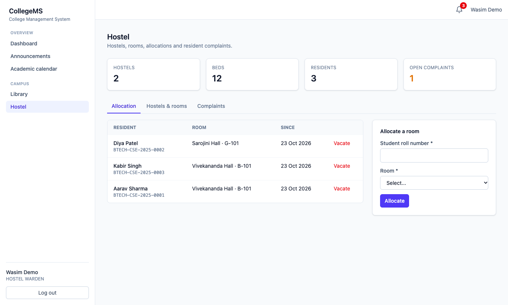{width=100%}

**Campus**, **Hostel**. Cards show hostels, beds, residents and open complaints.

- **Allocation** tab: enter the student's roll number and choose a room with free beds, then **Allocate**. A boys' hostel refuses a female student and the reverse; a full room is refused; a student can have only one active room. **Vacate** ends an allocation.
- **Hostels & rooms** tab: add hostels (Boys or Girls) and rooms (number, beds, fee per term).
- **Complaints** tab: **Start** moves a complaint to In progress; **Resolve** asks for a resolution note. The student is notified.

## 7.12 For the transport manager {#s7-12}

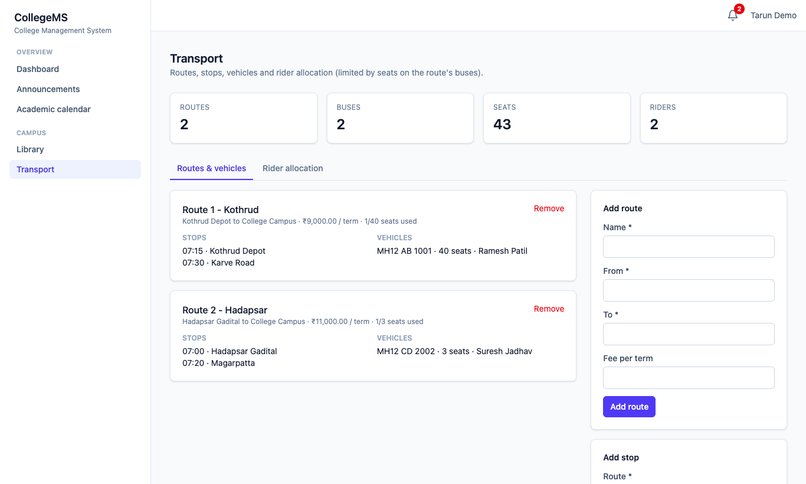{width=100%}

**Campus**, **Transport**. Cards show routes, buses, seats and riders.

- **Routes & vehicles** tab: add routes, then stops with pickup times, then vehicles with their seat count and route.
- **Rider allocation** tab: enter the student's roll number, choose a route (the list shows free seats) and optionally a stop, then **Allocate**. A route with no vehicle, or no free seats, refuses. **Cancel** ends an allocation.

## 7.13 For the placement officer {#s7-13}

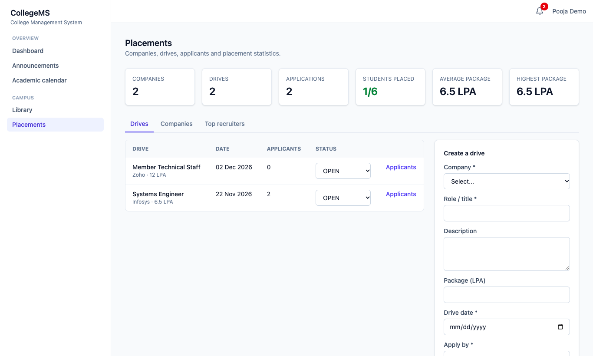{width=100%}

**Campus**, **Placements**. Cards show companies, drives, applications, students placed, average and highest package.

- **Companies** tab: add companies.
- **Drives** tab: create a drive (company, role, description, package, drive date, apply-by date, minimum CGPA). All students are notified. Change a drive's status (Open, Closed, Completed) in the table. Click **Applicants** to see each applicant with CGPA and move them between Applied, Shortlisted, Interview, Selected and Rejected; the student is notified at each change.
- **Top recruiters** tab: companies ranked by students selected.

## 7.14 A complete example from start to finish {#s7-14}

The sample data lets you follow one student through the whole system:

1. A visitor applies on the public form (Figure 4) and receives an application number.
2. The office verifies documents, scores the application and generates the merit list (Figure 30).
3. The accountant records the admission fee and the administrator enrolls the student, producing a roll number and login.
4. The HOD adds the student's batch timetable (Figure 36) and allocates teachers (Figure 32).
5. Faculty mark attendance daily (Figure 22) and absent students are notified.
6. The exam office creates an exam, teachers enter marks (Figure 23) and the exam office publishes results (Figure 35). Grades and CGPA appear in the student's results (Figure 11).
7. The accountant generates invoices for the batch, the student pays (Figure 12) and receives a receipt.
8. The AI analytics screen (Figure 38) flags students who are falling behind so the department can act early.

# 8. Business rules reference {#s8}

This section collects every rule the system applies, so that a number on screen can always be traced back to a definition.

## 8.1 Admission statuses {#s8-1}

| Status | Meaning | How it is reached |
|---|---|---|
| Submitted | Application received | Public form submitted |
| Documents pending | At least one document uploaded, not yet reviewed | Applicant uploads a document |
| Under review | Staff have scored it | **Mark under review** with entrance score |
| Merit listed | Ranked in the course's merit list | **Generate merit list** |
| Fee pending | Approved, waiting for the admission fee | **Approve** |
| Approved | Fee recorded | **Record fee payment** |
| Enrolled | Student account created | **Enroll student** |
| Rejected / Withdrawn | Closed without enrollment | **Reject**, or the applicant withdraws |

The merit list ranks all "Under review" applications of a course by entrance score, highest first, and gives them rank 1, 2, 3 and so on. Enrollment is allowed only for an Approved application whose fee is recorded and only into a batch of the applicant's own course.

## 8.2 Attendance {#s8-2}

- Statuses: Present, Absent, Late, Excused.
- **Attended** means Present or Late. **Classes held** means every class except Excused ones.
- Attendance percentage = attended divided by classes held, as a percentage with one decimal place.
- The minimum is **75%**. A subject or a student below it is flagged in red.
- Attendance cannot be marked for a future date. It is unique per subject, batch, date and period, so marking the same period again corrects it.
- Only the faculty member allocated to that subject and batch, an HOD or an administrator can mark.
- A student newly marked Absent is notified, and so are the linked parents.

## 8.3 Timetable {#s8-3}

A new class is refused if, on the same day and academic year and at an overlapping time, the same faculty member, the same batch or the same room already has a class. Two times overlap when each starts before the other ends. A class must end after it starts, and the subject must belong to the batch's course.

## 8.4 Exams {#s8-4}

- An exam belongs to a batch and a semester; its types are Internal, Midterm, Final and Online.
- A paper's date must fall inside the exam window, pass marks cannot exceed maximum marks, and a subject can have only one paper per exam.
- An online paper needs a duration, and students can start it only on the paper's date, only once, and only if at least one question exists. The timer is measured from the moment they start. Marks = (marks scored / total question marks) multiplied by the paper's maximum marks, rounded to two decimals.

## 8.5 Grading {#s8-5}

The percentage of a paper is marks obtained divided by maximum marks.

| Result | Grade | Grade points |
|---|---|---|
| Marks below the pass mark | F | 0 |
| Absent | AB | 0 |
| 90% and above | O | 10 |
| 80% to below 90% | A+ | 9 |
| 70% to below 80% | A | 8 |
| 60% to below 70% | B+ | 7 |
| 50% to below 60% | B | 6 |
| 40% to below 50% | C | 5 |
| Passed on pass marks but below 40% | D | 4 |

**Publishing** requires marks or an absence for every active student in every paper. Publishing locks the marks.

**SGPA** (semester grade point average) = the sum of (grade points x credits) divided by the sum of credits, over the papers of one final exam. It is written to the student's academic history, with the status Completed, or Backlog if any paper was failed or missed. Only exams of type Final affect SGPA.

**CGPA** (cumulative) = the sum of (grade points x credits) divided by the sum of credits, using the most recent published Final-exam result for each subject. A student with no published final result has no CGPA.

**Worked example** (from the sample data). Aarav's final results: Digital Logic Design 3 credits, grade A+ (9); Engineering Mathematics 4 credits, A (8); Engineering Physics 3 credits, A (8); Programming Fundamentals 4 credits, A (8). Sum of points x credits = 27 + 32 + 24 + 32 = 115. Total credits = 14. SGPA = CGPA = 115 / 14 = 8.21.

## 8.6 Fees {#s8-6}

- **Balance** of an invoice = total amount minus discount minus amount paid.
- An invoice is Pending, Partial (some paid), Paid, or Waived. **Overdue** is calculated, not stored: Pending or Partial and past its due date.
- A payment cannot exceed the balance, and a Paid or Waived invoice accepts no payment.
- Generating invoices for a batch totals the fee heads of the course that apply to the chosen semester (heads with no semester apply every time). It skips students who already have an invoice with the same title.
- Every payment gets a unique receipt number and the student and parents are notified.

## 8.7 Scholarships {#s8-7}

- A scheme gives either a percentage or a fixed amount, and may require a minimum CGPA. If the student already has a CGPA below the minimum the application is refused. A student can apply to a scheme once.
- On approval the discount is added to the student's open invoices. A **percentage** scheme takes that percentage of each open invoice's total, never more than the remaining balance. A **fixed** scheme is taken from the earliest-due invoice first, then the next, until used up.
- Invoices created after the approval are not discounted automatically.

## 8.8 Payroll {#s8-8}

- Net pay = basic + house rent allowance + other allowances - standard deductions - leave deduction.
- Leave deduction = (basic / 30) x the number of **approved Unpaid leave** days that fall inside the month.
- Regenerating a month recalculates unpaid payslips and leaves paid ones alone.

## 8.9 Library {#s8-9}

| Rule | Value |
|---|---|
| Loan limit | 3 books for students, 5 for faculty, 2 for other staff |
| Default loan period | 14 days (up to 60 can be chosen) |
| Renewal | 7 more days, at most 2 times, not allowed when overdue |
| Fine | 2.00 per day late, charged on return |
| Blocks a new loan | An overdue unreturned book, an unpaid fine, or already holding that title |

## 8.10 Hostel and transport {#s8-10}

- A hostel room accepts students only up to its beds. A student can hold one active room.
- A boys' hostel accepts male students and a girls' hostel female students (when the student's gender is recorded).
- A bus route accepts riders only up to the total seats of the vehicles assigned to it, and needs at least one vehicle. A student can hold one active allocation.

## 8.11 Placements {#s8-11}

A student can apply to a drive only if the drive is Open, the apply-by date has not passed, the drive is not restricted to a different course, and, when a minimum CGPA is set, the student has a published CGPA that meets it. A student can apply once per drive.

## 8.12 Assignments {#s8-12}

A student may submit or resubmit until the assignment is graded. A submission after the due date is flagged late but accepted. Marks cannot exceed the assignment's maximum. A graded submission is locked.

## 8.13 Leave {#s8-13}

A leave request has a type (Casual, Sick, Earned, Unpaid), start and end dates (end not before start) and a reason, and starts as Pending. It can be approved or rejected once only. A faculty member's status is not changed by leave; leave is judged by its dates.

## 8.14 Limits and formats {#s8-14}

| Item | Rule |
|---|---|
| Password | At least 8 characters |
| One-time code | 6 digits, valid 10 minutes |
| Failed sign-ins | 5 in a row locks the account for 15 minutes |
| Access token | 30 minutes |
| Refresh token | 7 days, single use |
| File upload | Up to 10 MB; pdf, png, jpg, jpeg, doc, docx, txt, zip, xlsx, csv |

# 9. The performance analysis explained {#s9}

## 9.1 What it is, and what it is not {#s9-1}

The analysis screens estimate which students may be struggling, explain why in plain terms, and forecast the next exam score. It is a **transparent weighted formula** and a **straight-line forecast**. It is not a trained machine-learning model: one college's records have no labelled history of who dropped out or failed, so there is nothing honest to train on. I chose a formula where every point can be explained to a teacher or a parent, rather than a black box that cannot justify its answer.

## 9.2 How the data reaches the service {#s9-2}

For each student the Java API collects: attendance percentage, average marks percentage across published results, the list of exam percentages in date order, the percentage of due assignments submitted, the amount of overdue fees, the number of failed or missed papers, and CGPA. It sends these as JSON to the Python service and receives the analysis.

## 9.3 The risk score {#s9-3}

The score is the sum of up to six factors, capped at 100. A factor that has no data (for example, no attendance recorded yet) contributes nothing.

| Factor | Maximum points | How points are earned |
|---|---|---|
| Attendance | 30 | Zero at 85% or above; rises in a straight line to the maximum at 30% |
| Marks | 30 | Zero at an average of 70% or above; maximum at an average of 20% |
| Score trend | 10 | Only if exam scores are falling; the maximum when they fall 20 points per exam |
| Assignments | 10 | Zero at 80% submitted or above; maximum at 0% |
| Backlogs | 12 | 4 points per failed or missed paper, up to 3 papers |
| Overdue fees | 8 | All 8 points if any fee is overdue |

**Levels:** 60 and above is **High**, 35 to 59 is **Medium**, below 35 is **Low**. **Confidence** is High when four or more factors had data, Medium for two or three, Low otherwise.

**Worked example** (Rohan Gupta in the sample data, Figure 38). Attendance 50.0% earns (85 - 50) / 55 x 30 = 19.1 points. Average marks 35.1% earn (70 - 35.1) / 50 x 30 = 20.9. No assignments were submitted, so 10. He has 7 failed or missed papers, so the 3-paper cap gives 12. He has an overdue fee, so 8. The trend factor is zero because his scores were not falling. Total = 70.0, which is High.

## 9.4 The forecast {#s9-4}

The exam percentages are treated as points (exam 1, exam 2, ...). The service fits the best straight line through them by least squares and extends it one exam ahead, limiting the result to between 0 and 100. With fewer than two exams there is no forecast. The slope of the line is the "points per exam" trend. It is a simple extrapolation and should be read as a hint, not a promise.

## 9.5 Recommendations {#s9-5}

Each factor above a threshold adds a plain suggestion: meet the student about attendance, arrange remedial sessions, review recent topics, follow up missing assignments, plan backlog clearance, refer to the accounts office.

## 9.6 If the service is off {#s9-6}

The main system continues to work. The screens that use analysis show a message saying the analytics service is not reachable, with a hint to start it.

# 10. Testing {#s10}

## 10.1 Automated end-to-end tests {#s10-1}

`python3 scripts/e2e.py` drives a running system through the API, as real clients would. It creates its own course and users each run, so it can be repeated against the same database. **301 checks pass.**

| Area | Checks | Examples |
|---|---|---|
| Authentication and access control | 22 | Wrong password rejected; unverified user cannot sign in; wrong code rejected; staff roles cannot self-register |
| Courses, subjects | 8 | Semesters generated; duplicate subject code refused |
| Faculty | 12 | Allocation conflict refused; leave decided once only; leave does not leave faculty stuck "on leave" |
| Admissions to enrollment | 28 | Enrollment refused before fee; documents uploaded without login; bad application id refused |
| Parent portal and per-student access | 11 | Wrong date of birth cannot link; parent blocked from another child; student blocked from a classmate |
| Attendance | 14 | Non-allocated faculty blocked; future date refused; 1 of 3 present gives 33.3%; low-attendance flag |
| Timetable | 8 | Faculty, batch and room clashes refused |
| Examinations and results | 40 | Answers not leaked in the paper; auto-grade 15/20; publish blocked while marks missing; marks locked after publish; CGPA 8.57; failing student gets F and Backlog |
| Fees and scholarships | 30 | Idempotent invoice generation; overpayment refused; classmate cannot pay; 50% scholarship gives exactly 1,000 on a 2,000 invoice |
| Payroll | 8 | 3 unpaid days deduct 6,000; net 67,000; faculty cannot read the payroll list |
| Library | 23 | Duplicate copy blocked; renew; fine of 10 for 5 late days; unpaid fine blocks a new loan |
| Hostel and transport | 19 | Gender rule; full room; no bus, full bus |
| Placements | 13 | Eligibility reasons; duplicate application refused |
| Learning, announcements, notifications | 28 | Non-allocated faculty cannot share; graded work locked; faculty cannot post public notices; broadcast reaches parents |
| Analysis, reports, performance | 23 | Struggling student scores higher than strong; CSV exports; faculty cannot see a colleague's report |
| User administration and sessions | 14 | Suspended token rejected immediately; password reset; two-factor sign-in; sign out everywhere |

The tests assert what must be **refused** as carefully as what must work, because for a system with money and records the refusals are what protect the data.

## 10.2 Browser testing {#s10-2}

Every screen was opened in a real browser for every role, and the browser console and network log were checked for errors. Interactive flows tested by hand in the browser included: signing in, attendance marking, taking an online exam, adding a timetable class, applying for admission and uploading a document, and allocating a subject to a teacher. The phone layout was checked at 375 px width, including the menu and that no page scrolls sideways.

## 10.3 Problems found by testing and fixed {#s10-3}

| Problem | Fix |
|---|---|
| Expired tokens returned 403, so the app never refreshed the sign-in | A proper 401 response for unauthenticated requests |
| Starting an online exam twice at once caused a conflict error | The insert now ignores duplicates |
| A bug in a text-block SQL string (a missing space) broke broadcast notifications | Fixed and covered by a test |
| Approving any leave marked the teacher "on leave" permanently | Leave no longer changes the teacher's status; one decision per request |
| Accountants could see the admissions page but the API refused the list | Accountants allowed to view admissions (needed for the fee step) |
| A suspended user's token kept working until it expired | Account status is checked on every request |
| OTP codes were written to the log everywhere | Logged only when explicitly enabled for development |
| The performance score under-rated an obviously struggling student | Thresholds made steeper (Section 9) |
| A duplicate React key warning on a dashboard | Fixed |
| No screen to allocate a subject to a faculty member | Added to the faculty page |

## 10.4 What is not covered {#s10-4}

There are no unit tests for individual classes, and there is no automated browser test; the browser checks above were manual. There was no load or performance test with large data volumes.

# 11. Troubleshooting {#s11}

| Symptom | Likely cause | What to do |
|---|---|---|
| Build errors mentioning missing getters or `cannot find symbol` | Using a Java version newer than 17 | Set `JAVA_HOME` to a JDK 17 and rebuild |
| API stops at start-up with a message about `JWT_SECRET` | The signing key is not set | Set `JWT_SECRET` (base64, 32 or more bytes); `dev.sh` does this for you |
| API stops with a Flyway "checksum mismatch" | The database was created by an older version of a migration | In development run `./scripts/dev.sh reset-db`. In production never edit applied migrations; add a new one |
| "password authentication failed" | `DB_PASSWORD` does not match the database user | Update the variable or run `./scripts/dev.sh start`, which re-applies the password |
| Port 8080, 5173, 5433 or 8000 already in use | Another program, or an old copy, is running | `./scripts/dev.sh stop`, or stop the other program |
| The browser shows the sign-in page again and again | Refresh token expired or the account was suspended | Sign in again; an administrator can check the account under **Users & roles** |
| No one-time code email arrives | SMTP is not configured | Set the `MAIL_*` variables. For development set `OTP_LOG_CODES=true` and read the code in the API log |
| Analysis screens say the service is not reachable | The Python service is not running | `./scripts/dev.sh start` (or start `uvicorn` on port 8000) |
| A teacher sees "No subjects allocated" | No subject allocation exists | Allocate subjects on the faculty page (Section 7.8.3) |
| "You are not allocated to teach this subject for this batch" | The teacher is not allocated, or the wrong batch is chosen | Allocate the subject, or choose the right class |
| Publish results says marks are missing | Some students have no marks in a paper | Open the paper's marks sheet and enter marks or tick Absent |
| Upload refused | File too large or type not allowed | Use a file under 10 MB of an allowed type |
| An online exam shows "Opens on exam day" | The paper's date is not today | Check the date of the paper |
| Blank white screen | The web app could not reach the API | Check `./scripts/dev.sh status` and the browser console |

# Appendix A. Sample accounts {#appA}

These accounts exist after running `python3 scripts/seed_demo.py`. They share one password, which is generated on your computer and printed when the script finishes (it is also in `.devdb-run/dev.env` as `DEMO_PASSWORD`). The administrator's password is in the same file as `BOOTSTRAP_ADMIN_PASSWORD`.

| Email | Role | Notes |
|---|---|---|
| student@college.edu | Student | Aarav Sharma, strong results; has a live online quiz |
| student2@college.edu to student6@college.edu | Students | Diya, Kabir, Meera, Rohan (student5, at risk), Sana |
| parent@college.edu | Parent | Linked to Aarav |
| faculty@college.edu | Faculty | Priya Nair: Programming Fundamentals, Digital Logic |
| faculty2@college.edu | Faculty | Rahul Verma: Mathematics, Physics |
| hod@college.edu | HOD | Computer Science and Engineering |
| principal@college.edu | Principal | |
| accountant@college.edu | Accountant | |
| librarian@college.edu | Librarian | |
| warden@college.edu | Hostel Warden | |
| transport@college.edu | Transport Manager | |
| placement@college.edu | Placement Officer | |
| admin@college.edu | Super Admin | Created from `BOOTSTRAP_ADMIN_*` |


# Appendix B. Database tables {#appB}

Table and column names, from the migration files (`backend/src/main/resources/db/migration`). V1 to V5 is the migration that creates the table.

| Migration | Table | Columns |
|---|---|---|
| V1 | `roles` | id, name, description |
| V1 | `users` | id, email, phone, password_hash, first_name, last_name, status, email_verified, two_factor_enabled, failed_login_attempts, locked_until, last_login_at, created_at, updated_at |
| V1 | `user_roles` | user_id, role_id |
| V1 | `otp_codes` | id, user_id, purpose, code_hash, expires_at, consumed_at, created_at |
| V1 | `refresh_tokens` | id, user_id, token_hash, expires_at, revoked_at, created_at |
| V1 | `departments` | id, name, code, hod_user_id, established_year, created_at, updated_at |
| V1 | `courses` | id, department_id, name, code, level, duration_years, total_semesters, total_seats, created_at, updated_at |
| V1 | `batches` | id, course_id, name, start_year, end_year, created_at |
| V1 | `semesters` | id, course_id, number, name |
| V1 | `subjects` | id, semester_id, name, code, credits, is_elective, created_at |
| V1 | `academic_calendar_events` | id, title, description, event_type, start_date, end_date, department_id, created_at |
| V1 | `faculties` | id, user_id, employee_code, department_id, designation, qualification, date_of_joining, employment_type, status, documents_verified, created_at, updated_at |
| V1 | `faculty_documents` | id, faculty_id, doc_type, file_url, verified, uploaded_at |
| V1 | `faculty_subject_allocations` | id, faculty_id, subject_id, batch_id, academic_year, created_at |
| V1 | `faculty_leaves` | id, faculty_id, leave_type, start_date, end_date, reason, status, approved_by, created_at |
| V1 | `admission_applications` | id, application_number, course_id, first_name, last_name, email, phone, date_of_birth, gender, address, guardian_name, guardian_phone, guardian_email, prior_education, entrance_exam_score, merit_score, merit_rank, status, review_notes, reviewed_by, reviewed_at, admission_fee_paid, admission_fee_amount, enrolled_student_id, created_at, updated_at |
| V1 | `admission_documents` | id, application_id, doc_type, file_url, verified, uploaded_at |
| V1 | `students` | id, user_id, admission_id, roll_number, id_card_number, course_id, batch_id, current_semester_id, date_of_birth, gender, blood_group, address, status, admitted_on, created_at, updated_at |
| V1 | `parents` | id, user_id, first_name, last_name, relation, phone, email, occupation, created_at |
| V1 | `student_parents` | student_id, parent_id, is_primary_contact |
| V1 | `student_academic_history` | id, student_id, semester_id, status, sgpa, created_at |
| V1 | `student_documents` | id, student_id, doc_type, file_url, uploaded_at |
| V3 | `attendance_sessions` | id, subject_id, batch_id, faculty_id, session_date, period, topic, created_at |
| V3 | `attendance_records` | id, session_id, student_id, status |
| V3 | `faculty_attendance` | id, faculty_id, att_date, status |
| V3 | `timetable_slots` | id, batch_id, subject_id, faculty_id, day_of_week, start_time, end_time, room, academic_year, created_at |
| V3 | `exams` | id, name, exam_type, batch_id, semester_id, academic_year, start_date, end_date, status, created_at |
| V3 | `exam_schedules` | id, exam_id, subject_id, exam_date, start_time, end_time, room, max_marks, pass_marks, is_online, duration_minutes |
| V3 | `exam_questions` | id, schedule_id, question_text, option_a, option_b, option_c, option_d, correct_option, marks |
| V3 | `exam_attempts` | id, schedule_id, student_id, started_at, submitted_at, score |
| V3 | `exam_answers` | id, attempt_id, question_id, selected_option |
| V3 | `results` | id, schedule_id, student_id, marks_obtained, absent, grade, grade_points, result_status |
| V4 | `fee_structures` | id, course_id, semester_id, name, amount, created_at |
| V4 | `fee_invoices` | id, invoice_number, student_id, title, total_amount, discount, paid_amount, due_date, status, created_at |
| V4 | `fee_payments` | id, invoice_id, amount, method, reference, receipt_number, paid_at, received_by |
| V4 | `scholarship_schemes` | id, name, description, discount_type, discount_value, min_cgpa, active, created_at |
| V4 | `scholarship_applications` | id, scheme_id, student_id, statement, status, remarks, discount_applied, applied_at, decided_at |
| V4 | `salary_structures` | faculty_id, basic, hra, allowances, deductions |
| V4 | `payslips` | id, faculty_id, month, year, basic, hra, allowances, deductions, unpaid_leave_days, leave_deduction, net_pay, status |
| V4 | `books` | id, isbn, title, author, publisher, category, total_copies, available_copies, shelf_location, created_at |
| V4 | `book_issues` | id, book_id, member_id, issued_on, due_on, returned_on, renewals, fine_amount, fine_paid |
| V4 | `hostels` | id, name, hostel_type, warden_id |
| V4 | `hostel_rooms` | id, hostel_id, room_number, capacity, fee_per_term |
| V4 | `hostel_allocations` | id, room_id, student_id, from_date, to_date, status |
| V4 | `hostel_complaints` | id, student_id, subject, description, status, resolution, created_at |
| V4 | `transport_routes` | id, name, start_point, end_point, fee_per_term |
| V4 | `transport_stops` | id, route_id, name, pickup_time, seq |
| V4 | `vehicles` | id, registration_no, capacity, driver_name, driver_phone, route_id |
| V4 | `transport_allocations` | id, student_id, route_id, stop_id, from_date, status |
| V5 | `stored_files` | id, original_name, content_type, size_bytes, storage_name, uploaded_by, created_at |
| V5 | `companies` | id, name, industry, website, contact_email |
| V5 | `placement_drives` | id, company_id, title, description, package_lpa, drive_date, last_apply_date, min_cgpa, course_id, status, created_at |
| V5 | `placement_applications` | id, drive_id, student_id, status, remarks, applied_at |
| V5 | `course_materials` | id, subject_id, batch_id, title, description, file_id, link_url, uploaded_by, created_at |
| V5 | `assignments` | id, subject_id, batch_id, title, description, due_date, max_marks, created_by, created_at |
| V5 | `assignment_submissions` | id, assignment_id, student_id, content, file_id, submitted_at, marks, feedback, graded_at |
| V5 | `announcements` | id, title, body, audience, batch_id, is_public, created_by, created_at |
| V5 | `notifications` | id, user_id, title, message, type, link, is_read, created_at |

# Appendix C. API reference {#appC}

Every endpoint begins with `/api`. "Roles" lists the roles allowed by the endpoint rule; "any signed-in user / public" means the rule is applied inside the method (for example, own records only) or the endpoint is public. Interactive documentation is served at `/docs` by the running API.


## Admissions {#admissions}

| Method | Path | Roles |
|---|---|---|
| POST | `/api/admissions/apply` | any signed-in user / public |
| GET | `/api/admissions/track/{applicationNumber}` | any signed-in user / public |
| GET | `/api/admissions/{id}/documents` | any signed-in user / public |
| POST | `/api/admissions/{id}/documents` | any signed-in user / public |
| POST | `/api/admissions/{id}/documents/upload` | any signed-in user / public |
| PATCH | `/api/admissions/{id}/withdraw` | any signed-in user / public |

## Attendance {#attendance}

| Method | Path | Roles |
|---|---|---|
| GET | `/api/attendance/student/{studentId}/records` | any signed-in user / public |
| GET | `/api/attendance/student/{studentId}/summary` | any signed-in user / public |

## Authentication {#authentication}

| Method | Path | Roles |
|---|---|---|
| POST | `/api/auth/forgot-password` | any signed-in user / public |
| POST | `/api/auth/login` | any signed-in user / public |
| POST | `/api/auth/logout` | any signed-in user / public |
| POST | `/api/auth/refresh` | any signed-in user / public |
| POST | `/api/auth/register` | any signed-in user / public |
| POST | `/api/auth/reset-password` | any signed-in user / public |
| POST | `/api/auth/verify-email` | any signed-in user / public |
| POST | `/api/auth/verify-login-otp` | any signed-in user / public |

## Courses and catalog {#courses-and-catalog}

| Method | Path | Roles |
|---|---|---|
| GET | `/api/calendar-events` | any signed-in user / public |
| GET | `/api/catalog/batches` | any signed-in user / public |
| GET | `/api/catalog/batches/{batchId}/subjects` | any signed-in user / public |
| GET | `/api/catalog/teaching` | any signed-in user / public |
| GET | `/api/courses` | any signed-in user / public |
| GET | `/api/courses/{courseId}/batches` | any signed-in user / public |
| GET | `/api/courses/{courseId}/semesters` | any signed-in user / public |
| GET | `/api/courses/{id}` | any signed-in user / public |
| GET | `/api/semesters/{semesterId}/subjects` | any signed-in user / public |

## Departments {#departments}

| Method | Path | Roles |
|---|---|---|
| GET | `/api/departments` | any signed-in user / public |
| GET | `/api/departments/{id}` | any signed-in user / public |

## Exams and results {#exams-and-results}

| Method | Path | Roles |
|---|---|---|
| GET | `/api/exams/my` | any signed-in user / public |
| GET | `/api/exams/{id}` | any signed-in user / public |
| GET | `/api/results/student/{studentId}` | any signed-in user / public |

## Faculty {#faculty}

| Method | Path | Roles |
|---|---|---|
| GET | `/api/faculty` | any signed-in user / public |
| GET | `/api/faculty/{id}` | any signed-in user / public |
| GET | `/api/faculty/{id}/allocations` | any signed-in user / public |
| GET | `/api/faculty/{id}/documents` | any signed-in user / public |
| GET | `/api/faculty/{id}/leaves` | any signed-in user / public |
| GET | `/api/faculty/{id}/performance` | any signed-in user / public |

## Fees {#fees}

| Method | Path | Roles |
|---|---|---|
| GET | `/api/fees/invoices` | any signed-in user / public |
| POST | `/api/fees/invoices` | any signed-in user / public |
| POST | `/api/fees/invoices/generate` | any signed-in user / public |
| POST | `/api/fees/invoices/{id}/pay` | any signed-in user / public |
| GET | `/api/fees/payments/{id}/receipt` | any signed-in user / public |
| GET | `/api/fees/structures` | any signed-in user / public |
| POST | `/api/fees/structures` | any signed-in user / public |
| DELETE | `/api/fees/structures/{id}` | any signed-in user / public |
| GET | `/api/fees/student/{studentId}` | any signed-in user / public |
| GET | `/api/fees/summary` | any signed-in user / public |

## Files {#files}

| Method | Path | Roles |
|---|---|---|
| POST | `/api/files` | any signed-in user / public |
| GET | `/api/files/{id}` | any signed-in user / public |

## Hostel {#hostel}

| Method | Path | Roles |
|---|---|---|
| GET | `/api/hostel/allocations` | any signed-in user / public |
| POST | `/api/hostel/allocations` | any signed-in user / public |
| POST | `/api/hostel/allocations/{id}/vacate` | any signed-in user / public |
| GET | `/api/hostel/complaints` | any signed-in user / public |
| PATCH | `/api/hostel/complaints/{id}` | any signed-in user / public |
| GET | `/api/hostel/hostels` | any signed-in user / public |
| POST | `/api/hostel/hostels` | any signed-in user / public |
| DELETE | `/api/hostel/hostels/{id}` | any signed-in user / public |
| GET | `/api/hostel/my` | any signed-in user / public |
| GET | `/api/hostel/rooms` | any signed-in user / public |
| POST | `/api/hostel/rooms` | any signed-in user / public |
| DELETE | `/api/hostel/rooms/{id}` | any signed-in user / public |

## Learning {#learning}

| Method | Path | Roles |
|---|---|---|
| GET | `/api/lms/assignments` | any signed-in user / public |
| POST | `/api/lms/assignments` | any signed-in user / public |
| GET | `/api/lms/assignments/my` | any signed-in user / public |
| DELETE | `/api/lms/assignments/{id}` | any signed-in user / public |
| GET | `/api/lms/assignments/{id}/submissions` | any signed-in user / public |
| GET | `/api/lms/materials` | any signed-in user / public |
| POST | `/api/lms/materials` | any signed-in user / public |
| DELETE | `/api/lms/materials/{id}` | any signed-in user / public |
| PATCH | `/api/lms/submissions/{id}/grade` | any signed-in user / public |

## Library {#library}

| Method | Path | Roles |
|---|---|---|
| GET | `/api/library/books` | any signed-in user / public |
| POST | `/api/library/books` | any signed-in user / public |
| DELETE | `/api/library/books/{id}` | any signed-in user / public |
| PUT | `/api/library/books/{id}` | any signed-in user / public |
| GET | `/api/library/issues` | any signed-in user / public |
| POST | `/api/library/issues` | any signed-in user / public |
| GET | `/api/library/issues/my` | any signed-in user / public |
| POST | `/api/library/issues/{id}/pay-fine` | any signed-in user / public |
| POST | `/api/library/issues/{id}/renew` | any signed-in user / public |
| POST | `/api/library/issues/{id}/return` | any signed-in user / public |
| GET | `/api/library/members/lookup` | any signed-in user / public |
| GET | `/api/library/stats` | any signed-in user / public |

## Notifications and announcements {#notifications-and-announcements}

| Method | Path | Roles |
|---|---|---|
| GET | `/api/announcements` | any signed-in user / public |
| GET | `/api/announcements/public` | any signed-in user / public |
| GET | `/api/notifications` | any signed-in user / public |
| POST | `/api/notifications/read-all` | any signed-in user / public |
| GET | `/api/notifications/unread-count` | any signed-in user / public |
| POST | `/api/notifications/{id}/read` | any signed-in user / public |

## Parent portal {#parent-portal}

| Method | Path | Roles |
|---|---|---|
| POST | `/api/parents/link` | PARENT |
| GET | `/api/parents/me/children` | PARENT |

## Payroll {#payroll}

| Method | Path | Roles |
|---|---|---|
| POST | `/api/payroll/generate` | any signed-in user / public |
| GET | `/api/payroll/payslips` | any signed-in user / public |
| PATCH | `/api/payroll/payslips/{id}/pay` | any signed-in user / public |
| GET | `/api/payroll/structures` | any signed-in user / public |
| PUT | `/api/payroll/structures/{facultyId}` | any signed-in user / public |

## Performance analysis {#performance-analysis}

| Method | Path | Roles |
|---|---|---|
| GET | `/api/analytics/student/{studentId}` | any signed-in user / public |

## Placements {#placements}

| Method | Path | Roles |
|---|---|---|
| PATCH | `/api/placement/applications/{id}` | any signed-in user / public |
| GET | `/api/placement/companies` | any signed-in user / public |
| POST | `/api/placement/companies` | any signed-in user / public |
| DELETE | `/api/placement/companies/{id}` | any signed-in user / public |
| GET | `/api/placement/drives` | any signed-in user / public |
| POST | `/api/placement/drives` | any signed-in user / public |
| GET | `/api/placement/drives/{id}/applications` | any signed-in user / public |
| PATCH | `/api/placement/drives/{id}/status` | any signed-in user / public |

## Reports {#reports}

| Method | Path | Roles |
|---|---|---|
| GET | `/api/reports/admissions-funnel` | SUPER_ADMIN, COLLEGE_ADMIN, PRINCIPAL, HOD, ACCOUNTANT |
| GET | `/api/reports/attendance` | SUPER_ADMIN, COLLEGE_ADMIN, PRINCIPAL, HOD, ACCOUNTANT |
| GET | `/api/reports/enrollment` | SUPER_ADMIN, COLLEGE_ADMIN, PRINCIPAL, HOD, ACCOUNTANT |
| GET | `/api/reports/export/{dataset}` | SUPER_ADMIN, COLLEGE_ADMIN, PRINCIPAL, HOD, ACCOUNTANT |
| GET | `/api/reports/fees` | SUPER_ADMIN, COLLEGE_ADMIN, PRINCIPAL, HOD, ACCOUNTANT |
| GET | `/api/reports/overview` | SUPER_ADMIN, COLLEGE_ADMIN, PRINCIPAL, HOD, ACCOUNTANT |
| GET | `/api/reports/results` | SUPER_ADMIN, COLLEGE_ADMIN, PRINCIPAL, HOD, ACCOUNTANT |

## Scholarships {#scholarships}

| Method | Path | Roles |
|---|---|---|
| GET | `/api/scholarships/applications` | any signed-in user / public |
| PATCH | `/api/scholarships/applications/{id}/decide` | any signed-in user / public |
| GET | `/api/scholarships/schemes` | any signed-in user / public |
| POST | `/api/scholarships/schemes` | any signed-in user / public |
| PATCH | `/api/scholarships/schemes/{id}/active` | any signed-in user / public |

## Students {#students}

| Method | Path | Roles |
|---|---|---|
| GET | `/api/students/{id}` | any signed-in user / public |
| GET | `/api/students/{id}/academic-history` | any signed-in user / public |
| GET | `/api/students/{id}/documents` | any signed-in user / public |
| POST | `/api/students/{id}/documents` | any signed-in user / public |
| POST | `/api/students/{id}/documents/upload` | any signed-in user / public |
| GET | `/api/students/{id}/parents` | any signed-in user / public |

## Timetable {#timetable}

| Method | Path | Roles |
|---|---|---|
| GET | `/api/timetable/my` | any signed-in user / public |

## Transport {#transport}

| Method | Path | Roles |
|---|---|---|
| GET | `/api/transport/allocations` | any signed-in user / public |
| POST | `/api/transport/allocations` | any signed-in user / public |
| POST | `/api/transport/allocations/{id}/cancel` | any signed-in user / public |
| GET | `/api/transport/my` | any signed-in user / public |
| GET | `/api/transport/routes` | any signed-in user / public |
| POST | `/api/transport/routes` | any signed-in user / public |
| DELETE | `/api/transport/routes/{id}` | any signed-in user / public |
| POST | `/api/transport/stops` | any signed-in user / public |
| DELETE | `/api/transport/stops/{id}` | any signed-in user / public |
| POST | `/api/transport/vehicles` | any signed-in user / public |
| DELETE | `/api/transport/vehicles/{id}` | any signed-in user / public |

## User administration {#user-administration}

| Method | Path | Roles |
|---|---|---|
| GET | `/api/users/me` | any signed-in user / public |
| POST | `/api/users/me/change-password` | any signed-in user / public |
| POST | `/api/users/me/logout-all` | any signed-in user / public |
| GET | `/api/users/me/sessions` | any signed-in user / public |
| PATCH | `/api/users/me/two-factor` | any signed-in user / public |

# Appendix D. Configuration settings {#appD}

| Variable | Required | Meaning |
|---|---|---|
| `DB_HOST`, `DB_PORT`, `DB_NAME`, `DB_USER` | Defaults: localhost, 5432, college_db, college_app | Database location |
| `DB_PASSWORD` | Yes | Database password |
| `JWT_SECRET` | Yes | Base64 key (32 or more bytes) used to sign tokens |
| `BOOTSTRAP_ADMIN_EMAIL` | Default admin@college.edu | Email of the first Super Admin |
| `BOOTSTRAP_ADMIN_PASSWORD` | To create the first admin | Used only when no Super Admin exists |
| `CORS_ORIGINS` | Default http://localhost:5173 | Comma-separated allowed browser origins |
| `MAIL_HOST`, `MAIL_PORT`, `MAIL_USER`, `MAIL_PASSWORD` | For email | SMTP server for one-time codes |
| `UPLOAD_DIR` | Default ./uploads | Folder for uploaded files |
| `AI_SERVICE_URL` | Default http://localhost:8000 | Address of the analysis service |
| `OTP_LOG_CODES` | Development only | Writes one-time codes to the log |
| `POSTGRES_PASSWORD` | For docker compose | Password for the container database |

# Appendix E. Glossary {#appE}

| Term | Meaning |
|---|---|
| API | The server program that the web application talks to |
| Batch | Students who joined a course in the same year |
| BCrypt | A slow one-way function used to store passwords safely |
| CGPA / SGPA | Cumulative / semester grade point average |
| CORS | Browser rule about which web addresses may call the API |
| CSV | A plain table file that opens in Excel |
| Flyway | Tool that applies numbered SQL files to build the database |
| JPA / Hibernate | Java tools that map classes to database tables |
| JWT | A signed token proving who you are |
| Migration | A numbered SQL file describing a database change |
| OTP | One-time password: a short code that can be used once |
| PWA | A website that can be installed on a phone like an app |
| RBAC | Role-based access control |
| SPA | Single-page application: pages change without reloading |
| UUID | A long unguessable identifier |
